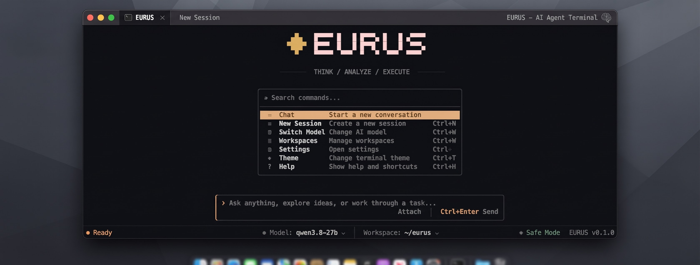
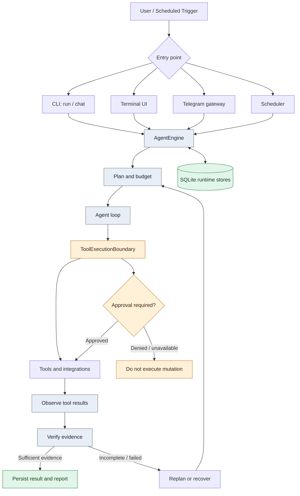
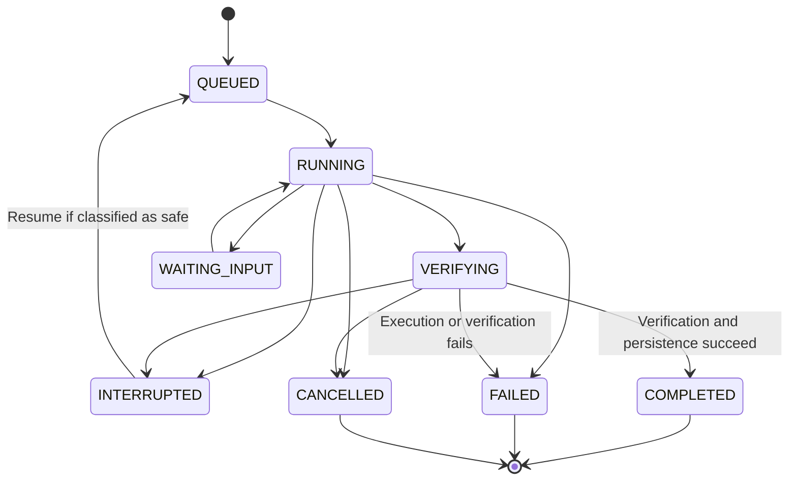

<p align="center">
  
</p>

<h1 align="center">EURUS</h1>

<p align="center">
  <strong>An experimental, provider-agnostic AI agent runtime for real work in your terminal.</strong>
  <br>
  Shell and workspace tools, coding workflows, web research, persistent execution, and optional integrations.
</p>

<p align="center">
  
  
  
  
</p>

<p align="center">
  <a href="#what-is-eurus">Overview</a> ·
  <a href="#capabilities">Capabilities</a> ·
  <a href="#quick-start">Quick start</a> ·
  <a href="#architecture">Architecture</a> ·
  <a href="#safety-model">Safety</a> ·
  <a href="#documentation">Docs</a>
</p>

> [!WARNING]
> **Eurus is pre-alpha software.** APIs, configuration, persistence schemas, and behavior may change without notice. Expect rough edges. Do not rely on it for critical or unattended production work, and review every proposed or executed change.

## What is Eurus?

Eurus is an async-first Python agent runtime that connects language models to tools and repeatable workflows. It is designed to do more than answer a prompt: an agent can plan a task, call tools, inspect results, make follow-up decisions, and report what it could verify.

Eurus is provider-agnostic. It supports several model-provider protocols and OpenAI-compatible endpoints, with configurable fallback chains. The runtime includes a terminal interface, workspace-oriented coding tools, web research, SQLite-backed execution records, and optional integrations such as Telegram and MCP.

The project is being developed with small servers and Android Termux in mind. Optional integrations should remain optional; the core is not designed to require Docker or a native compilation toolchain.

## Preview
<p align="center">
  
</p>


## Capabilities

| Area | What is included |
|---|---|
| **Model providers** | OpenAI-compatible APIs, Anthropic, Gemini REST, and optional official Groq and Google GenAI SDK integrations |
| **Agent execution** | Async tool-calling loop, bounded iterations, timeouts, retry/fallback handling, and interruption support |
| **Coding workflows** | Workspace inspection, guarded file operations, patch proposals, validation tools, and multi-file workflows |
| **Runtime durability** | `AgentEngine`, SQLite-backed run/event/tool-attempt/job stores, checkpoints, task-state snapshots, and recovery classification |
| **Verification** | Step and completion checks that distinguish supported results from unverified claims; criteria-aware step verification |
| **Safety controls** | Approval hooks for mutating tools, workspace/path controls, action journaling, network guards, and redaction |
| **Memory and sessions** | Local SQLite session history, FTS5 keyword search, trust-tiered memory, and budgeted memory injection into prompts |
| **Research and browser** | Web search/fetch tools; optional browser automation integration |
| **Extensibility** | Custom tools, validated skill learning with quarantined drafts and owner-approved promotion, optional MCP integration, document workflows, and Telegram gateway |
| **Terminal UI** | CLI and interactive TUI with themes, model selection, and runtime feedback |

Availability and maturity vary by feature. See the [roadmap](docs/ROADMAP.md) and the relevant module documentation before relying on a specific workflow.

## Architecture

Production task execution is intended to converge on one durable execution boundary: `AgentEngine` in `src/eurus/runtime/engine.py`. Entry points and interfaces may differ, but the runtime lifecycle is shared.



### Execution lifecycle



The runtime includes explicit run states, budget tracking, event persistence, tool-attempt records, verification outcomes, and recovery checks. A persisted status is not by itself proof that the underlying task was successful; inspect the evidence and trace when evaluating a run.

See [Architecture and Execution Flow](docs/ARCHITECTURE.md) for implementation details.

## Quick start

### Requirements

- Python 3.11 or newer
- Git
- An API key for the provider/model you intend to use
- Network access for remote model providers and web research

### Install from source

```bash
git clone https://github.com/kyyinfinite/eurus.git
cd eurus

python -m venv .venv
source .venv/bin/activate

python -m pip install --upgrade pip
pip install -e ".[dev]"

cp .env.example .env
```

Add your provider key to `.env` or export it in your shell. For example:

```bash
export GROQ_API_KEY="your-key"
eurus doctor
eurus providers
```

Do not commit `.env` or real credentials.

### Ask a model

```bash
eurus ask --model groq/llama-3.3-70b-versatile \
  "Explain what a mutex is in three sentences."
```

### Run an agent task

```bash
eurus run "Inspect this project and summarize its structure."
```

### Start an interactive chat

```bash
eurus chat
```

### Launch the terminal UI

```bash
eurus-tui
```

Exact provider/model availability depends on your provider account and configuration. Model IDs in examples are illustrative and may need to be changed.

## Configure providers

Eurus uses `provider/model` identifiers. Provider credentials should be supplied through environment variables rather than checked into config files.

Useful commands:

```bash
eurus config init
eurus config show
eurus config path
eurus providers
eurus doctor
eurus diagnose
```

Example provider configuration:

```toml
[providers.myhost]
protocol = "openai"
base_url = "https://example.com/v1"
api_key_env = "MYHOST_API_KEY"
```

A simple model and fallback configuration can look like this:

```toml
[agent]
model = "groq/llama-3.3-70b-versatile"
fallback = ["gemini/gemini-2.0-flash"]
iteration_budget = 100

[network]
timeout_seconds = 120.0
max_retries = 3
local_only = false
```

Configuration precedence, provider protocols, SDK extras, and troubleshooting are documented in [Provider Configuration](docs/PROVIDERS.md).

## Use Eurus on Termux

Eurus aims to keep its core dependency footprint practical for Android Termux and small Linux servers. Platform support still depends on the tools and integrations selected.

```bash
pkg install python git
python -m pip install --upgrade pip
pip install -e .
eurus doctor
```

Termux does not provide a Docker-style container runtime by default, so Eurus defaults to the non-isolated host backend with `sandbox.required = false` there. Commands run on the host and are **not isolated by a container**; the approval gate is the only control before execution. Use this mode only when you understand the implications and can review approvals carefully.

See the Termux notes in the project documentation before enabling shell execution.

## Safety model

Eurus includes safety mechanisms, but these do not make an autonomous agent risk-free.

- **Approval-gated mutations:** tools marked as mutating or approval-required are routed through an approval boundary. If no approver is available, the boundary is designed to deny the operation.
- **Guarded workspace operations:** coding tools include checks intended to constrain file operations and detect stale patches.
- **Execution records:** tool attempts and outcomes can be recorded to help diagnose partial or uncertain operations.
- **Recovery caution:** unresolved side effects should be classified before resuming a run; do not blindly replay a task that may already have changed external state.
- **Network restrictions:** guarded URL handling rejects non-HTTP(S) schemes and blocks local/private destinations where the guarded network path is used.
- **Secret redaction:** runtime event payloads pass through redaction before persistence.

These controls are defense-in-depth, not a security certification. Review the code, test it in a disposable workspace, and keep backups before allowing the agent to modify valuable files or use external services. Never give an experimental agent unrestricted access to secrets or production infrastructure.

Report security concerns privately according to [SECURITY.md](SECURITY.md).

## Useful commands

| Command | Purpose |
|---|---|
| `eurus ask ...` | Send a one-shot prompt to a model |
| `eurus run ...` | Run an agent task |
| `eurus chat` | Interactive conversation with persistent session support |
| `eurus-tui` | Launch the terminal UI |
| `eurus providers` | List configured provider options |
| `eurus doctor` | Check local setup |
| `eurus diagnose` | Diagnose provider/model connectivity |
| `eurus sessions list` | List saved sessions |
| `eurus memory search "query"` | Search stored memory |
| `eurus skills list` | List quarantined skill drafts learned from tasks |
| `eurus skills promote NAME --yes --outcome ...` | Validate and install a learned skill with owner approval |
| `eurus skills patch NAME --content-file F` | Update an installed skill with a versioned backup |
| `eurus eval --compare-learning` | Run the eval suite with lessons off/on and report regressions |
| `eurus trace <run_id>` | Inspect a redacted runtime timeline |
| `eurus inspect` | Inspect run details |
| `eurus history` | Review previous runs |
| `eurus events` | Examine persisted events |
| `eurus metrics` | Display runtime metrics |

Use `eurus --help`, `eurus <command> --help`, and `eurus-tui --help` for the commands available in your installed version.

## Optional integrations

Install only the extras you need:

```bash
pip install -e ".[web]"      # Web search and fetch (ddgs + trafilatura)
pip install -e ".[mcp]"        # Model Context Protocol
pip install -e ".[telegram]"   # Telegram gateway
pip install -e ".[browser]"    # Browser integration
pip install -e ".[documents]"  # Office/document workflows
pip install -e ".[groq]"       # Official Groq SDK
pip install -e ".[genai]"      # Google GenAI SDK
```

Browser automation may require separate browser binaries and platform setup. Installing the Python extra alone does not guarantee that a browser can launch on every operating system.

## Documentation

- [Architecture and Execution Flow](docs/ARCHITECTURE.md) — runtime boundary, lifecycle, persistence, and recovery
- [Roadmap](docs/ROADMAP.md) — current priorities and planned work
- [Provider Configuration](docs/PROVIDERS.md) — providers, fallbacks, and diagnostics
- [Web Research](docs/WEB_RESEARCH.md) — search and fetch tools
- [Task Execution](docs/TASK_EXECUTION.md) — execution model and task workflows
- [MCP Integration](docs/MCP.md) — optional MCP support
- [Multi-file Workflow](docs/MULTI_FILE_WORKFLOW.md) — workspace coding workflow
- [Office Artifacts](docs/OFFICE_ARTIFACTS.md) — document and office file tools
- [Clean-room Notes](docs/CLEAN_ROOM.md) — project design and provenance notes
- [Memory](docs/MEMORY.md) — long-lived memory configuration and prompt injection
- [Task Execution](docs/TASK_EXECUTION.md) — run lifecycle, budgets, checkpoints, and undo
- [Reminders](docs/REMINDERS.md) — persistent Telegram reminders
- [Contributing](CONTRIBUTING.md) — development workflow
- [Security Policy](SECURITY.md) — reporting security issues

## Development

```bash
pip install -e ".[dev]"
ruff check .
ruff format --check .
python -m compileall -q src
mypy
pytest -q
```

The CI workflow runs linting, formatting, type checks, tests, packaging checks, command smoke tests, and documentation-link checks on Python 3.11—3.13. Local results may differ when network access, optional dependencies, or platform facilities are unavailable.

## Project status

**Pre-alpha · Active development**

Eurus is an evolving research and engineering project. Features may be incomplete, behavior may change, and test coverage does not imply production readiness. The roadmap prioritizes runtime reliability, safe recovery, practical deployment, and deterministic evaluation.

If you experiment with Eurus, please include reproducible steps, environment details, relevant logs with secrets removed, and the expected versus actual behavior when reporting an issue.

## License

Eurus is released under the [MIT License](LICENSE).

# sentinel
