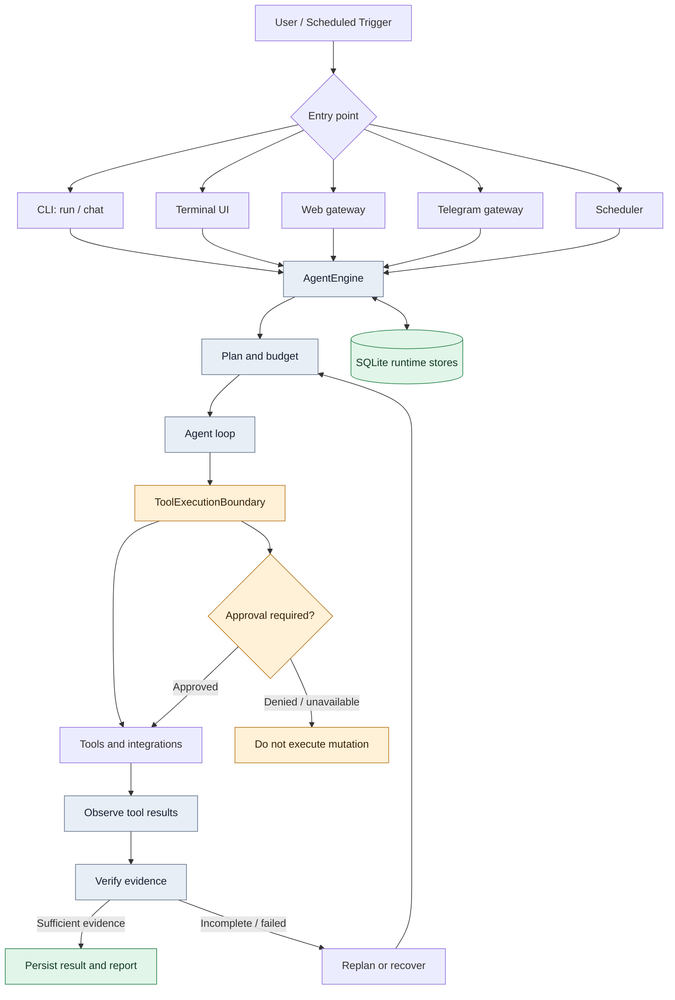
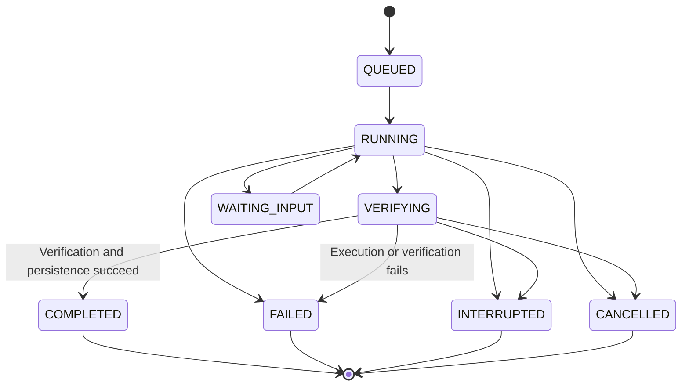

<p align="center">
  
</p>

<h1 align="center">EURUS</h1>

<p align="center">
  <strong>A provider-agnostic AI agent runtime for real work in your terminal.</strong>
  <br>
  Durable execution, approval-gated tools, coding workflows, web research, MCP, and a local web gateway.
</p>

<p align="center">
  
  
  
  
  
</p>

<p align="center">
  <a href="#overview">Overview</a> ·
  <a href="#features">Features</a> ·
  <a href="#quick-start">Quick start</a> ·
  <a href="#architecture">Architecture</a> ·
  <a href="#safety-model">Safety</a> ·
  <a href="#command-reference">Commands</a> ·
  <a href="#configuration">Configuration</a> ·
  <a href="#development">Development</a>
</p>

<p align="center">
  
</p>

> [!WARNING]
> **Eurus is pre-alpha software.** APIs, configuration, persistence schemas, and behavior may change without notice. Do not rely on it for critical or unattended production work, and review every proposed or executed change.

## Overview

Eurus is an async-first Python agent runtime that connects language models to tools and repeatable workflows. An agent can plan a task, call tools, inspect the results, decide what to do next, and report only what it could verify.

- **Provider-agnostic.** OpenAI-compatible endpoints, Anthropic, Gemini, and optional official Groq and Google GenAI SDKs, with configurable fallback chains.
- **Durable by design.** Every run goes through one execution boundary, `AgentEngine`, which persists runs, events, tool attempts, checkpoints, approvals, and budgets in SQLite.
- **Honest about results.** A run is not marked `COMPLETED` until verification and persistence succeed. Unsupported claims are recorded as unverified, never as success.
- **Fail-closed safety.** Mutating tools need an approver. With no approver, the action is denied.
- **Small-footprint friendly.** Built with Android Termux and small VPS instances in mind. Optional integrations stay optional, and the core needs neither Docker nor a native compiler.

## Features

| Area | What is included |
|---|---|
| **Model providers** | Built-in catalog: OpenAI, Anthropic, Gemini, Groq, NVIDIA NIM, OpenRouter, DeepSeek, Mistral, Together, xAI, Ollama, plus any OpenAI-compatible endpoint. Fallback chains, retry with backoff, cooldowns, and `eurus diagnose` |
| **Agent execution** | Async tool-calling loop, deterministic and structured planners, bounded iterations, token/cost/time budgets, interruption and cancellation |
| **Durable runtime** | SQLite stores for runs, events, tool attempts, jobs, and checkpoints. Write-ahead tool attempts, safe resume, and recovery classification |
| **Verification** | Step and completion checks that separate supported results from unverified claims. Research answers must carry citations |
| **Coding workflows** | Guarded file tools, project index, reviewable patchsets with SHA-256 freshness checks, validation runner, per-run undo, and disposable git worktrees for coder subagents |
| **Web research** | `web_search`, `web_fetch`, and `deep_search` with no search API key, all behind a DNS-pinning network guard |
| **Browser automation** | Snapshot-driven Chromium control by element reference. Pure-Python CDP backend (Termux-friendly) or Playwright |
| **MCP platform** | Native MCP client and server, risk-classified tools, and nine built-in Google Workspace services with OAuth 2.0 |
| **Memory and learning** | Trust-tiered memory with FTS5 retrieval, bounded prompt injection, lessons, and validated skill learning with owner-approved promotion |
| **Interfaces** | CLI, interactive terminal UI, local web gateway (React), Telegram gateway with durable tasks and reminders, and a scheduler |
| **Documents** | Read and create `.docx`, `.xlsx`, and `.pptx` with an approval-gated review workflow |
| **Observability** | Redacted traces, run inspection, history, events, and metrics, all read-only |

Maturity varies by feature. See [Known limitations](#known-limitations) before relying on a specific workflow.

## Architecture

All production entry points converge on one durable execution boundary, `AgentEngine` in `src/eurus/runtime/engine.py`. Interfaces differ, but execution, persistence, verification, and recovery are shared.



| Layer | Responsibility | Location |
|---|---|---|
| `AgentEngine` | Run lifecycle, checkpoints, budgets, cancellation, state-machine validation, final verification | `runtime/engine.py` |
| Agent loop and planners | Iteration, replanning, step and completion verification | `agent/` |
| `ToolExecutionBoundary` | Approval, mutation path locks, uncertain-outcome tracking, execution envelope enforcement | `tools/boundary.py` |
| Stores | Runs, events, tool attempts, jobs, checkpoints, sessions, memory, media | `storage/`, `sessions.py`, `memory/` |
| Recovery | Classifies interrupted runs and blocks unsafe resume | `runtime/resume.py` |
| Redaction and net guard | Secret redaction before persistence, validated network egress | `security/` |

### Run lifecycle



The state machine rejects invalid transitions. If completion lacks sufficient evidence, the outcome is recorded as `completed_unverified`. A persisted status alone is not proof that the task succeeded, so inspect the evidence with `eurus trace`.

### Durability and recovery

Each run records its identity, ordered runtime events, checkpoints (including a capped history snapshot so a resumed run keeps its context), tool attempts, approval decisions with action fingerprints, verification evidence, and budget snapshots.

- **Write-ahead tool attempts.** Mutating tools persist a `pending` row before they run. A crash leaves a reconcilable trace instead of silence.
- **No blind replay.** Runs with unresolved side effects are blocked from resuming until the target state is reconciled by hand. Approvals are re-validated at resume time.
- **Observable failures.** Checkpoint failures surface as `checkpoint.failed` events. They never kill the run, and they are never silent.
- **Bounded resources.** Subprocess output uses head+tail bounded readers, and event buffers are capped with dropped-event counters.
- **Storage.** SQLite in WAL mode with a small thread-safe connection pool and additive, versioned migrations.

## Quick start

### Requirements

- Python 3.11 or newer (CI covers 3.11 to 3.13)
- Git
- An API key for the provider you intend to use
- Network access for remote providers and web research
- Docker (or a compatible runtime) if you want isolated shell execution on Linux. See [Shell isolation](#shell-isolation)

### Install from source

```bash
git clone https://github.com/kyyinfinite/eurus.git
cd eurus

python -m venv .venv
source .venv/bin/activate

python -m pip install --upgrade pip
pip install -e ".[dev]"      # or just: pip install -e .
```

### Bootstrap the environment (recommended)

The built-in environment manager detects your platform (Termux, Debian/Ubuntu proot, native Linux, containers/VPS), installs the feature extras you choose, writes the `~/.eurus/` layout, configures a provider, and verifies the result.

```bash
eurus bootstrap --check      # read-only inspection
eurus bootstrap              # interactive dashboard
eurus bootstrap --quick      # guided end-to-end setup
eurus bootstrap --repair     # show a repair plan, confirm, apply
eurus doctor                 # health report (--full adds live probes, --repair offers fixes)
eurus setup provider         # also: browser, mcp, telegram, startup, config
```

Everything bootstrap changes lives under `~/.eurus/` (directories `0700`, secrets `0600`), is backed up before repair, and is recorded in `~/.eurus/bootstrap/state.json`. Sample files are in [`examples/bootstrap/`](examples/bootstrap).

### Configure a provider

Put your key in `~/.eurus/.env` (or the current directory's `.env`), or export it in your shell:

```bash
export GROQ_API_KEY="your-key"
eurus doctor
eurus providers
```

Never commit `.env` or real credentials. The repository ships [`.env.example`](.env.example) as a template.

### Use it

```bash
eurus ask --model groq/llama-3.3-70b-versatile "Explain what a mutex is in three sentences."
eurus run "Inspect this project and summarize its structure."
eurus chat                     # interactive, with persistent sessions
eurus-tui                      # terminal UI (also: eurus tui)
eurus gateway web --open       # local web UI on http://127.0.0.1:8712
```

Model IDs in examples are illustrative and depend on your provider account.

## Configuration

Eurus reads `~/.eurus/config.toml` (override the home with `EURUS_HOME`). A complete annotated example is in [`eurus.example.toml`](eurus.example.toml). Manage it with:

```bash
eurus config init
eurus config show
eurus config path
eurus setup config            # interactive manager
```

### Providers and fallbacks

Models are addressed as `provider/model`. Each provider declares a protocol (`openai`, `anthropic`, `gemini`, `groq-sdk`, or `genai-sdk`), a base URL, and the environment variable holding its key.

```toml
[agent]
model = "groq/llama-3.3-70b-versatile"
fallback = ["openai/gpt-4o-mini"]
iteration_budget = 500

[providers.myhost]
protocol = "openai"
base_url = "https://example.com/v1"
api_key_env = "MYHOST_API_KEY"

[network]
timeout_seconds = 120.0
max_retries = 3
local_only = false          # true = only loopback, private ranges, Tailscale
cooldown_seconds = 30.0
retry_jitter = 0.0
first_token_seconds = 0     # 0 disables the first-token deadline
```

Request behavior:

- Rate limits, timeouts, and 5xx responses are retried with backoff and honor `Retry-After`.
- Request-scoped failures (invalid request, unknown model) move to the next fallback without cooling down a healthy provider.
- Authentication failures skip every remaining candidate on the same provider.
- Failed providers enter a cooldown and are skipped while healthy alternatives exist.
- A stream is retried or failed over only before its first token. After that, the turn ends with an error instead of replaying partial output.
- Failures are classified structurally from exception types and error codes. Unknown errors are never assumed retryable.

`.env` loading is deliberately narrow: only variables ending in `_API_KEY`, plus `OLLAMA_BASE_URL` and `NVIDIA_BASE_URL`. Existing environment values always win. Set `EURUS_NO_DOTENV=1` to disable it.

`eurus diagnose` probes the model chain without running an agent and reports a reason code per model (`edge_blocked`, `model_blocked`, `region_blocked`, `forbidden`):

```bash
eurus diagnose groq/llama-3.3-70b-versatile nvidia/meta/llama-3.3-70b-instruct
```

### Budgets and cost honesty

`BudgetSpec` bounds iterations, wall-clock time, tool calls, parallelism, model calls, tokens, and cost. Cost budgets apply only when a price is known for every model used. Otherwise the run reports `cost.tracking_unavailable` and never shows an invented estimate. Override prices in `$EURUS_HOME/prices.toml`:

```toml
[models."groq/llama-3.3-70b-versatile"]
input_per_mtok = 0.59
output_per_mtok = 0.79
```

### Optional extras

```bash
pip install -e ".[web]"          # extra web research dependencies (ddgs, trafilatura)
pip install -e ".[web-gateway]"  # FastAPI web gateway
pip install -e ".[telegram]"     # Telegram gateway
pip install -e ".[browser]"      # Playwright backend (PC/VPS)
pip install -e ".[browser-cdp]"  # raw CDP backend (Termux-friendly)
pip install -e ".[documents]"    # .docx / .xlsx / .pptx tools
pip install -e ".[google]"       # OS keyring + encrypted token storage
pip install -e ".[groq]"         # official Groq SDK
pip install -e ".[genai]"        # Google GenAI SDK
pip install -e ".[mcp]"          # redundant: MCP is a core dependency
```

## Safety model

Eurus is built to fail closed, but safety controls do not make an autonomous agent risk-free.

- **Approval-gated mutations.** Tools marked as mutating or approval-required pass through an approval boundary. With no approver available, the operation is denied. CLI approval is scoped to the displayed tool call, so changing the command needs a new approval.
- **Execution envelope.** Every tool call is authorized by an immutable `ExecutionEnvelope` carrying run identity, workspace, isolation backend, network profile (default `offline`), capabilities, resource budget, approval scope, and optional expiry. Cancelled, expired, cross-run, or capability-missing calls are denied before any handler runs and emitted as `envelope.violation` events.
- **Guarded workspace.** One shared resolver enforces relative paths only, no `..`, no symlinks, and strict containment. Security-sensitive writes use descriptor-relative `O_NOFOLLOW` opens to block symlink-swap races. Writes are atomic.
- **Network guard.** Web tools allow public HTTP(S) only. Loopback, private, link-local, CGNAT, multicast, and metadata addresses are rejected. Redirects are validated hop by hop, and connections are pinned to the validated address against DNS rebinding.
- **Untrusted content.** Web pages, retrieved memory, emails, documents, and MCP output are treated as data, never as instructions. Remote MCP output is wrapped in an untrusted-content guard.
- **Secret redaction.** Event payloads, approval arguments, logs, and traces pass through redaction before they are stored or shown. Memory writes are screened for credential patterns.
- **Recovery caution.** Unresolved side effects block resume. Identical mutating calls stay blocked across restarts until reconciled.
- **Audit journal.** Security events (sandbox unavailable, image rejected, host mode in use, and more) are written to `<home>/security/execution.jsonl` with owner-only permissions.

These controls are defense-in-depth, not a security certification. Test in a disposable workspace, keep backups, and never give an experimental agent unrestricted access to secrets or production infrastructure. To report a vulnerability, see [SECURITY.md](SECURITY.md).

### Shell isolation

By default the shell tool runs inside a container and Eurus never silently falls back to the host.

- Defaults: no network, read-only root filesystem, all capabilities dropped, `no-new-privileges`, non-root user mapped from the host uid:gid, and CPU, memory, PID, timeout, and output limits. The workspace is mounted writable, so back it up before approving commands.
- If the runtime is missing or unhealthy, execution fails with `sandbox_unavailable` instead of running on the host.
- Optional hardening: image allowlist, digest pinning, a bundled default-deny seccomp profile, and an AppArmor profile.
- Containers carry `eurus.*` identity labels. Orphans are force-removed on timeout and swept on every run.

```toml
[sandbox]
backend = "container"            # or "host" (explicit compatibility mode)
runtime = "docker"
image = "python:3.12-alpine"
required = true
network = false
memory_mb = 1024
cpu_limit = 1.0
pids_limit = 128
user = "auto"
image_allowlist = []
digest_pin_required = false
seccomp_profile = ""             # "" | "default" | path
apparmor_profile = ""
```

**Termux and host mode.** Termux has no Docker-style runtime, so Eurus defaults to the non-isolated host backend with `sandbox.required = false` there. Commands then run directly on the device and are **not isolated**. The approval gate is your only control, so review every approval carefully. Host mode is explicit-only, warns at startup, and is distinguishable in the audit journal.

## Execution and tasks

### Task execution

`AgentEngine` creates a `QUEUED` run, transitions it to `RUNNING`, streams ordered events, saves checkpoints every `checkpoint_interval_steps`, then moves to `VERIFYING` before recording `COMPLETED` or `FAILED`. A final budget snapshot records token usage and, when pricing is known, estimated cost.

- **Orchestration.** `SubagentOrchestrator` runs a task graph with a shared iteration budget, per-node allowlists, and bounded retries. Every child result is unverified until the parent confirms it.
- **Delegation.** `delegate_task` runs a read-only subagent. `delegate_code_task` runs a coder subagent in a disposable git worktree. Its diff is reviewed for path traversal, symlinks, binary content, and secret exposure, then returned as a proposal only. Integration happens through `apply_patch` with owner approval. Children run through `AgentEngine` with their own durable records and never orphan in `RUNNING`.
- **Resume.** `eurus resume <run_id>` resumes runs with a usable checkpoint, blocks runs with unresolved side effects, and sends runs without a checkpoint to manual review. Resumed runs receive a directive to verify current state before continuing.
- **Failure classes.** Failures are classified as transient, permanent, policy, interrupted, or uncertain. Gateway tasks retry only transient failures within `max_attempts` (default 1). Jobs with an expired lease after a side-effect boundary land in `unknown_outcome`.
- **Undo.** Before an approved mutating file tool runs, the engine snapshots the target files under `$EURUS_HOME/undo/<run_id>.json`. `/undo` in the TUI or `eurus undo <run_id>` restores them, but only if the file still matches what the run wrote. Files over 1 MB or not valid UTF-8 are skipped, and shell mutations are not captured.

### Coding workflow

- **Tools:** `read_file` (line ranges), `edit_file` (exact replace with optional `base_sha256`), `create_file`, `apply_patch`, `preview_patchset`, `apply_patchset`, and `run_checks`.
- **Patchsets** carry the SHA-256 of the reviewed content. Any drift aborts the whole set, and restore points can roll back an approved patchset when validation fails.
- **Project index** renders modules, imports, and symbols into context so edits respect the real structure.
- **Validation runner** executes an allowlisted set of checks (pytest, mypy, compile checks). It is not a shell.
- Every mutating file tool is `mutates=True`, `requires_approval=True`, and serialized per path by the boundary lock.

### Documents

`document_read`, `document_create`, `document_replace`, `excel_create`, `powerpoint_create`, `office_team_create`, and `office_replace` work on `.docx`, `.xlsx`, and `.pptx` (install the `[documents]` extra). The document team (proofreader, engagement editor, critical reviewer, lead producer) proposes revisions but never writes them. Writes go only through approval-gated tools, and replacement checks a SHA-256 of the reviewed content so a stale review cannot overwrite a changed file.

## Web research and browser

### Web research

| Tool | Description |
|---|---|
| `web_search` | Public web search through DDGS: titles, URLs, snippets |
| `web_fetch` | Fetches one public HTTP(S) page and extracts readable text (2 MB cap) |
| `deep_search` | Searches, fetches up to five sources in parallel, and returns evidence with source URLs |

No search API key is needed. The completion verifier rejects research conclusions that lack citations or web evidence in the transcript.

### Browser automation

Eurus can drive a real Chromium browser. It reads a compact accessibility snapshot of interactive elements and acts by reference (`[e3] button "Create project"`), not by guessed CSS selectors. Every page-changing result returns a fresh snapshot, and stale references return a clear error.

| Backend | Extra | Notes |
|---|---|---|
| `cdp` | `[browser-cdp]` | Speaks the DevTools Protocol directly. No Playwright, Node.js, or compiler. Default on Termux |
| `playwright` | `[browser]` | Auto-waiting locators. Not available on Android |
| `remote` / `attach` | `[browser-cdp]` | Connects to an externally managed Chromium and never closes it |
| `auto` | none | Default: `cdp` on Termux, `playwright` when importable, otherwise `cdp` |

```bash
# Termux
pkg install x11-repo && pkg install chromium
pip install -e ".[browser-cdp]"

# PC / VPS
pip install -e ".[browser]" && playwright install chromium
```

```toml
[browser]
enabled = true        # the browser is disabled by default
backend = "auto"
```

Security: HTTP(S) only, local and cloud-metadata addresses blocked, per-request subresource guard, optional `allowed_domains` and `blocked_domains`, and a dedicated Eurus profile at `~/.eurus/browser/profile` that never touches your normal Chrome profile. Clicks, typing, key presses, option selection, dialogs, screenshots, and uploads always need individual owner approval and can never be session-scoped. Put `{{secret:NAME}}` in typed text to inject `EURUS_SECRET_NAME` at execution time without exposing it to the model.

```bash
eurus browser status | start | stop | config
eurus browser login [url]      # manual login handoff into the Eurus profile
eurus browser test --network
```

## MCP and Google Workspace

Eurus is both an **MCP client** and an **MCP server**. The SDK (`mcp>=1.27,<2`) is a core dependency, and every entry point builds its MCP stack through one `MCPRuntime`.

### External servers

```bash
eurus mcp add-stdio filesystem python --arg server.py
eurus mcp add-http my-server https://example.com/mcp
eurus mcp list | test [name] | remove <name> | doctor | tools | permissions
```

Servers are stored in `~/.eurus/mcp.json` and connect independently, so a failing server never disconnects healthy ones. States are `disabled`, `disconnected`, `connecting`, `connected`, `failed`, and `reauth_required`. HTTP servers must use `https://`. Plain `http://` is accepted only for loopback.

### Risk classification

Every MCP tool is classified at registration time, before any agent loop runs, and the model cannot override it.

| Level | Examples | Approval |
|---|---|---|
| `read_only` | search email, read documents | Not required (configurable) |
| `reversible_write` | create draft or document | Required |
| `sensitive_mutation` | send email, share files, change permissions | Required, cannot be disabled |
| `destructive` | delete email or Drive files | Required, cannot be disabled |
| `unknown` | unmatched tools, all external-server tools by default | Required |

Rules live in `~/.eurus/security/mcp-policies.json`. Explicit rules beat the built-in classification, but no configuration can remove approval from sensitive or destructive actions.

### Google Workspace

Nine services are built in and **disabled by default**: Gmail, Drive, Docs, Sheets, Slides, Calendar, Chat, People, and Classroom. Eurus connects to Google's managed endpoints, discovers tools live (`mcp_google_<service>_<tool>`), and requests only the scopes of enabled services.

```bash
eurus mcp google list
eurus mcp google enable gmail
eurus auth google login            # --no-browser prints the URL for headless devices
eurus mcp google status | test
eurus auth google status | accounts | use <email> | logout [--all]
```

Setup outline: create a Google Cloud project, configure the OAuth consent screen, create a **Desktop app** OAuth client with **"Use this client for an AI-powered agent"** enabled, enable the needed `*mcp.googleapis.com` services with `gcloud services enable`, then give Eurus the credentials via `EURUS_GOOGLE_CLIENT_ID` and `EURUS_GOOGLE_CLIENT_SECRET` (or `~/.eurus/auth/google/client.json`). Chat needs a Workspace account and a configured Chat app, and Classroom needs an Education account.

OAuth uses authorization code flow with PKCE and a random `state`. Tokens go to the OS keyring when available, otherwise to files encrypted with a passphrase-derived key (PBKDF2-HMAC-SHA256, 600k iterations, via `EURUS_GOOGLE_TOKEN_PASSPHRASE`). Plaintext storage is never a silent fallback. On Termux, install `.[google]` and export the passphrase variable.

> The Google Workspace MCP servers are part of Google's Developer Preview program. Availability and tool sets may change, and Eurus reports per-service errors instead of failing the whole MCP stack.

### Eurus as an MCP server

```bash
eurus mcp server tools                                   # list tools with mutating/approval flags
eurus mcp server start --transport stdio --tool read_file --tool search_memory
eurus mcp server start --transport streamable-http --host 127.0.0.1 --port 8765 --tool read_file
```

Nothing is exposed by default. Tools are allowlisted explicitly (`--tool` or `~/.eurus/security/server-access.json`), arguments are schema-validated, and calls pass through the same execution boundary. HTTP always requires a bearer token (`--token` or `EURUS_MCP_SERVER_TOKEN`), non-loopback binds without one are refused, and mutating tools are denied to external clients unless `allow_mutating` is explicitly enabled. Credentials are never exposed as tools.

## Interfaces

### Terminal UI

`eurus-tui` (or `eurus tui`) is an interactive TUI with themes, model selection, runtime feedback, and slash commands: `/help`, `/model`, `/models`, `/provider`, `/theme`, `/font`, `/glyphs`, `/sessions`, `/resume`, `/retry`, `/clear`, `/compact`, `/undo`, `/tools`, `/skills`, `/memory`, `/browser`, `/workspace`, `/grants`, `/config`, `/settings`, `/status`, and `/exit`. Manage themes with `eurus theme list|use|new|path` and terminal fonts with `eurus font list|status|reset`. You can also bundle your own `.ttf` or `.otf` fonts under `src/eurus/tui/assets/fonts/`.

### Web gateway

A local REST + WebSocket API and React frontend over the **same** runtime, sessions, approvals, and stores as the CLI and TUI. It is a new interface, not a second implementation. A session created in the TUI is visible in the browser and vice versa.

```bash
eurus gateway web                      # binds 127.0.0.1:8712 and prints a token URL
eurus gateway web --open --port 9000
EURUS_GATEWAY_TOKEN=... eurus gateway web
```

Build the frontend once (`cd frontend && npm ci && npm run build`), or use the Vite dev server (`npm run dev`, which proxies `/api` to `:8712`). Without a build, the gateway still serves the API and a hint page. The token is stored in `~/.eurus/gateway-web.json` (`0600`).

Highlights: welcome screen with a central composer, floating chat on every page, three-pane chat workspace, multimodal composer (images, documents, audio, voice notes, drag-and-drop, paste), approval broker shared across browser clients, and dashboard, runs, sessions, memory, providers, tools, logs, security, and configuration pages.

Local security: loopback by default, host-header allowlist (DNS rebinding), bearer-token auth on all routes and WebSocket upgrades, Origin/Referer validation on state-changing requests, no cookies, secrets never leave the process, and no shell, filesystem, or tool access from the frontend. Uploads are validated (20 MB cap, MIME allowlist, magic-byte sniffing, filename sanitization).

### Telegram gateway

```bash
pip install -e ".[telegram]"
eurus setup telegram             # stores the bot token and allowlist (0600)
eurus gateway telegram
```

Tasks persist in `gateway_tasks` with run linkage, attempt caps, and deadlines. After a restart, queued tasks are re-dispatched. Interrupted tasks resume only after the user sends `/resume` (with `--ack-side-effects` when side effects may have started), and `/pause` interrupts a task while keeping its state recoverable. Approvals happen in chat and are denied by default in background jobs.

**Reminders.** The agent tools `create_reminder`, `list_reminders`, `reschedule_reminder`, and `cancel_reminder` create persistent reminders that survive restarts. They need a concrete ISO-8601 `due_at` with timezone (default `EURUS_REMINDER_TIMEZONE`, which defaults to `Asia/Jakarta`), and recurring reminders use `interval_seconds` (minimum 60). Reminders are claimed transactionally with bounded retry, are scoped to the owner and conversation, and skip missed intervals rather than flooding after downtime. Delivery is at-least-once at a crash boundary, because Telegram has no idempotency key for `sendMessage`. Natural-language cancellation ("stop reminding me") is supported.

### Scheduler

```bash
eurus schedule add ...           # also: list, enable, disable, history, cancel-run, profile-save
eurus schedule daemon            # runs each due job through its own engine
```

## Memory, sessions, and skills

### Memory

Long-lived memory lives in `~/.eurus/data/eurus.sqlite3` with SQLite FTS5 keyword retrieval and no vector service. An optional hybrid provider adds fuzzy lexical matching over hashed n-gram vectors, which is deterministic feature hashing and **not** learned semantic embeddings.

```toml
[memory]
enabled = true
max_memories = 2000
retention_days = 0        # 0 disables time-based expiry
max_content_chars = 500
```

- Automatic extraction is deterministic and runs only over the user's own message, recognizing explicit statements such as `Remember that ...`, preferences, project decisions, and validated workflows. Tool, file, and web output is never trusted as memory policy.
- Types: `profile`, `preference`, `project_fact`, `fact`, `episode`, `procedural`, `agent_note`, `lesson`. Each records confidence, source, scope, and provenance.
- Project-scoped memories are retrieved only in their scope. Duplicates are rejected, and writes are screened for credentials and sensitive personal data.
- Memories are injected under a bounded character budget (default 1800), labeled `[memory]`, and kept separate from lessons. **Quarantined memories are never injected.** Memory is advisory and cannot weaken execution policy.
- `eurus memory add|list|search|update|delete|promote|quarantine`, plus `eurus privacy export|purge`.

### Skills and learning

Built-in skills under `src/eurus/skills/builtin/` are prompt assets for UI, layout, copywriting, code quality, document, and presentation work. Learned skills are drafted into quarantine and installed only after validation and owner approval:

```bash
eurus skills list | show | validate
eurus skills promote NAME --yes --outcome "..."
eurus skills patch NAME --content-file F       # versioned backup
eurus eval --compare-learning                  # eval suite with lessons off vs on
```

## Command reference

Use `eurus --help`, `eurus <command> --help`, and `eurus-tui --help` for what your installed version provides.

| Command | Purpose |
|---|---|
| `eurus ask ...` | One-shot prompt to a model |
| `eurus run ...` | Run an agent task |
| `eurus chat` | Interactive conversation with persistent sessions |
| `eurus-tui` / `eurus tui` | Terminal UI |
| `eurus gateway web` / `telegram` / `status` / `prune` | Web gateway, Telegram gateway, and gateway maintenance |
| `eurus providers` / `eurus diagnose` | List providers, probe the model chain |
| `eurus doctor` | Health report (`--full`, `--repair`) |
| `eurus bootstrap` / `eurus setup ...` | Environment manager and component setup |
| `eurus config init\|show\|path` | Configuration |
| `eurus sessions list\|show\|summarize\|delete` | Session history |
| `eurus memory ...` / `eurus privacy ...` | Memory management and privacy export/purge |
| `eurus skills ...` / `eurus learn consolidate` | Skills and learning |
| `eurus mcp ...` / `eurus auth google ...` | MCP client/server and Google auth |
| `eurus browser ...` | Browser backend control |
| `eurus schedule ...` | Scheduled jobs and the daemon |
| `eurus tools` | List registered tools |
| `eurus trace <run_id>` | Redacted runtime timeline |
| `eurus inspect` / `history` / `events` / `metrics` | Read-only run inspection |
| `eurus resume <run_id>` / `cancel` / `undo <run_id>` | Run recovery, cancellation, and undo |
| `eurus eval` / `benchmark` | Deterministic evaluation suite |
| `eurus theme ...` / `eurus font ...` | TUI themes and fonts |

## Storage layout

`HomeManager` is the single resolver for every filesystem location. The home is `~/.eurus` (override with `EURUS_HOME`), created lazily with `0700` permissions that are re-tightened if they drift.

| Path | Contents |
|---|---|
| `config.toml`, `.env`, `mcp.json`, `prices.toml` | Configuration and credentials-by-reference |
| `data/eurus.sqlite3` | Runtime database: sessions, runs, events, attempts, memory, reminders. Legacy `sessions.sqlite3` is adopted automatically through a checkpointed, verified, lock-serialized copy, and the legacy file is preserved |
| `workspace/` | Managed scopes: `projects/`, `temp/runs/`, `automation/`, `shared/`, `artifacts/` |
| `skills/`, `browser/`, `media/`, `undo/`, `evals/`, `themes/`, `bootstrap/`, `auth/` | Owned by their subsystems |
| `security/` | Policies and the execution audit journal |
| `system/` | Runtime-owned version and manifest, never agent-accessible |

Your configured default workspace stays where you set it and is never cleaned or moved. `WorkspaceManager` validates scope IDs, rejects traversal, absolute paths, NUL bytes, and symlinks on strict paths, and sweeps only ephemeral scopes.

## Known limitations

- **Docker isolation is not yet validated against a real daemon.** The hardened container invocation is covered by mock-based tests only. Rootless mode and the bundled seccomp profile are untested. Treat the sandbox as unvalidated until you have verified it on your own host.
- **Termux runs unisolated.** Host mode relies entirely on the approval gate.
- **Browser DNS-rebinding gap.** Chromium resolves third-party subresources itself, so the HTTP-tool style address pinning does not apply there. Run Eurus on a trusted network for sensitive browsing. Downloads started by clicks are not intercepted, so use `browser_download` with a direct URL.
- **Web gateway providers are text-only.** Uploaded images, audio, and video are stored and referenced, but not sent as vision or audio content. Text documents are inlined.
- **Approvals are per-process.** Approvals for TUI-started runs are resolved in the TUI. Gateway runs share approvals across browser clients.
- **Undo covers file tools only.** Shell mutations, files over 1 MB, and non-UTF-8 files are not restored.
- **Google Workspace MCP is a Developer Preview** and may change.
- **Memory retrieval is lexical.** There are no learned embeddings yet.

## Roadmap

Planned: richer deterministic verifiers selected by plan step and changed files, session-scoped approvals for narrowly defined safe patterns with expiry and revocation, optional remote embedding providers for memory retrieval, and more orchestration roles on the graph scheduler behind the same trusted boundary.

Non-goals: replacing the human approver for mutating actions, mandatory heavyweight infrastructure (Docker-only sandboxes, vector databases, native compilation), and treating model, subagent, or web claims as proof of success.

## Development

```bash
pip install -e ".[dev]"
ruff check .
ruff format --check .
python -m compileall -q src
mypy
pytest -q
```

CI runs linting, formatting, strict type checks, tests, packaging checks, and command smoke tests on Python 3.11 to 3.13. Results may differ locally when network access, optional dependencies, or platform facilities are unavailable. Browser integration tests launch a real Chromium and are skipped when it is unavailable.

Frontend (`frontend/`, React + TypeScript + Vite + Tailwind):

```bash
cd frontend && npm ci
npm run dev        # Vite on :5173
npm test           # vitest
npm run build      # tsc --noEmit && vite build
```

Helpful extras live in `benchmarks/` (routing, gateway, offline, and TUI benchmarks) and `scripts/` (gateway smoke checks, live gateway check, Pterodactyl start helper).

### Project layout

```text
src/eurus/
├── agent/          loop, planners, verification, delegation
├── runtime/        AgentEngine, state machine, recovery
├── tools/          registry and ToolExecutionBoundary
├── execution/      execution envelope, container sandbox
├── coding/         file tools, patchsets, checks, office tools
├── providers/      protocol adapters and router
├── browser/        CDP and Playwright backends, snapshots, policy
├── mcp/            client, server, Google Workspace provider, OAuth
├── gateway/        web (FastAPI) and telegram
├── memory/ learning/ skills/ sessions.py
├── tui/ cli/ bootstrap/
└── security/       redaction, net guard, audit journal
frontend/           React web gateway UI
tests/              deterministic test suite
```

## Contributing

1. Fork the repository and branch from `main`.
2. Install with `pip install -e ".[dev]"`.
3. Run `ruff check .`, `ruff format --check .`, `mypy`, and `pytest` before opening a pull request.
4. Keep pull requests small and focused, with tests for behavior changes.

Code rules: Eurus is implemented from scratch, and its design is informed by studying open-source agent projects, not by copying their code. Do not paste or translate code from other projects, including AGPL or GPL projects. Code from permissively licensed projects may be used only with its notice recorded in a `NOTICE` file. When reporting an issue, include reproducible steps, environment details, logs with secrets removed, and expected versus actual behavior.

## Security

Please do not open public issues for vulnerabilities. See [SECURITY.md](SECURITY.md) for how to report them privately.

## License

Eurus is released under the [MIT License](LICENSE).
