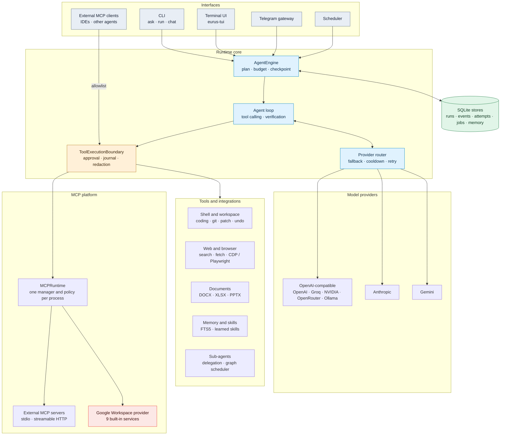
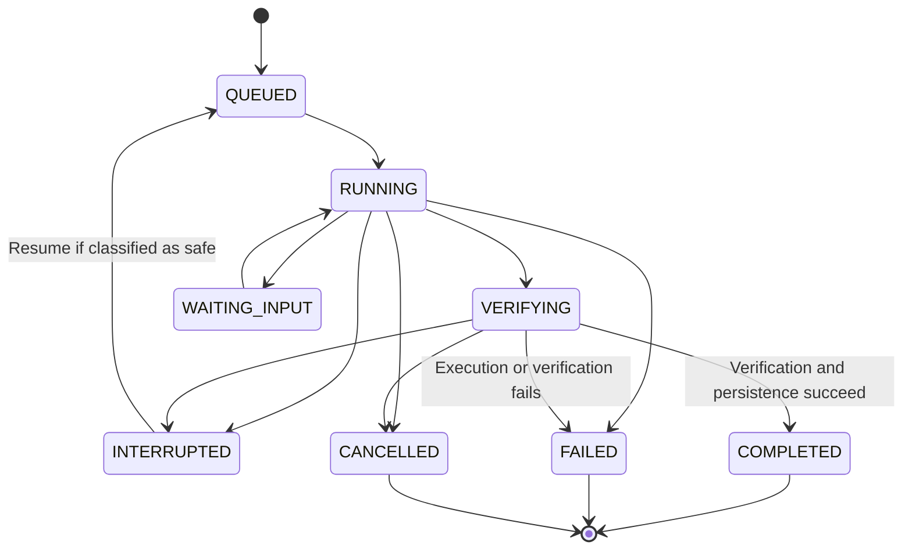
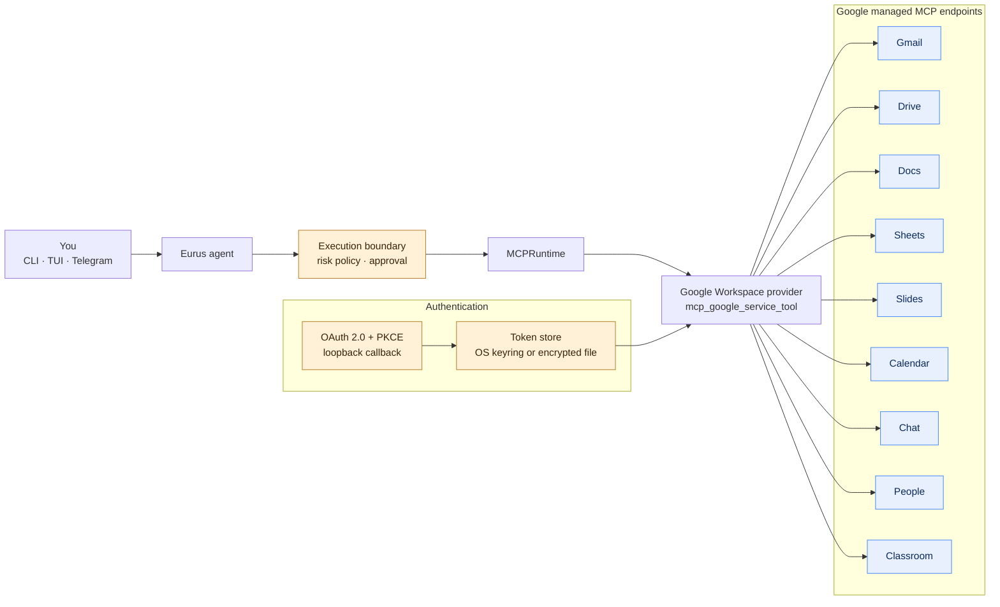
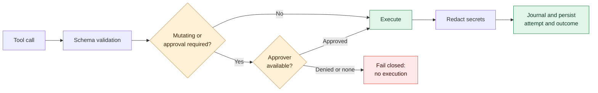

<p align="center">
  
</p>

<h1 align="center">EURUS</h1>

<p align="center">
  <strong>An experimental, provider-agnostic AI agent runtime for real work in your terminal.</strong>
  <br>
  Shell and workspace tools · coding workflows · web research · durable execution · MCP · Google Workspace
</p>

<p align="center">
  
  
  
  
  
</p>

<p align="center">
  <a href="#-overview">Overview</a> ·
  <a href="#-architecture">Architecture</a> ·
  <a href="#-google-workspace-built-in-mcp">Google Workspace</a> ·
  <a href="#-quick-start">Quick start</a> ·
  <a href="#-terminal-ui">Terminal UI</a> ·
  <a href="#-safety-model">Safety</a> ·
  <a href="#-documentation">Docs</a>
</p>

> [!WARNING]
> **Eurus is pre-alpha software.** APIs, configuration, persistence schemas, and behavior may change without notice. Do not rely on it for critical or unattended production work, and review every proposed or executed change.

---

## ✨ Overview

Eurus is an async-first Python agent runtime that connects language models to tools and repeatable workflows. An agent can plan a task, call tools, inspect the results, make follow-up decisions, and report what it was actually able to verify.

- **Provider-agnostic.** OpenAI-compatible endpoints, Anthropic, Gemini, and optional official Groq / Google GenAI SDKs, with configurable fallback chains.
- **Durable by design.** Every run goes through one execution boundary (`AgentEngine`) backed by SQLite: events, tool attempts, checkpoints, recovery.
- **Native MCP platform.** Eurus is both an MCP **client** and an MCP **server**, and ships a **built-in Google Workspace provider**.
- **Built for small machines.** Android Termux and small VPS instances are first-class targets. No Docker, vector database or native compiler is required.

### Capabilities at a glance

| Area | What is included |
|---|---|
| 🧠 **Model providers** | OpenAI, Anthropic, Gemini, Groq, NVIDIA NIM, OpenRouter, DeepSeek, Mistral, Together, xAI, Ollama, plus any OpenAI-compatible endpoint |
| 🔁 **Agent execution** | Async tool-calling loop, bounded iterations, timeouts, retry / fallback, cancellation, resume |
| 🛠️ **Coding workflows** | Workspace inspection, guarded file operations, patch proposals, validation, git tools, undo, multi-file workflows |
| 🗄️ **Runtime durability** | SQLite run / event / tool-attempt / job stores, checkpoints, task-state snapshots, recovery classification |
| ✅ **Verification** | Step and completion checks that separate supported results from unverified claims |
| 🔐 **Safety controls** | Fail-closed approval for mutating tools, path controls, action journal, network guard, secret redaction |
| 💾 **Memory & sessions** | Session history, FTS5 keyword search, trust-tiered memory, budgeted prompt injection |
| 🌐 **Research & browser** | Web search / fetch, snapshot-driven browser automation (pure-Python CDP for Termux, optional Playwright) |
| 🧩 **Extensibility** | Custom tools, validated skill learning (quarantine → owner-approved promotion), sub-agent delegation, Telegram gateway, scheduler |
| 🔌 **MCP** | External MCP servers (stdio / HTTP), Eurus as an MCP server, and **9 built-in Google Workspace services** |
| 📄 **Documents** | DOCX / XLSX / PPTX creation and editing workflows |
| 🎨 **Terminal UI** | Interactive TUI with 9 built-in themes, font support, glyph sets, model picker and slash commands |

---

## 🧱 Architecture

All entry points converge on one durable execution boundary. Tool calls always pass through the same approval and execution boundary, whether they come from a built-in tool, an external MCP server or Google Workspace.



### Run lifecycle



A persisted status is not by itself proof that a task succeeded: inspect the evidence and trace (`eurus trace <run_id>`). Details: [Architecture and Execution Flow](docs/ARCHITECTURE.md).

---

## 🔌 Google Workspace (built-in MCP)

Eurus ships a native provider for Google's official Workspace MCP servers. There is nothing to clone or run locally: Eurus connects to Google's managed endpoints and authenticates with your own Google account through OAuth 2.0.

<p align="center">
  
  
  
  
  
</p>
<p align="center">
  
  
  
  
</p>

> [!NOTE]
> The Google Workspace MCP servers are part of Google's **Developer Preview Program**. Availability, tool sets and verification requirements may change, and not every Google account or project has access to every service. Eurus reports per-service connection errors instead of failing the whole MCP stack.

### Supported services

All nine services are included but **disabled by default**. Only the scopes of the services you enable are requested at login.

| Service | What the agent can do | Notes |
|---|---|---|
|  | Search and read threads, create drafts, send messages | Send / delete always need explicit approval |
|  | Search and read files, write files the app creates | `drive.readonly` + per-file `drive.file` |
|  | Read and edit documents | Drive scopes + Docs scopes |
|  | Read and edit spreadsheets | Drive scopes + Sheets scopes |
|  | Read and edit presentations | Drive scopes + Slides scopes |
|  | Calendar list, free/busy, events (read) | Read-oriented scopes |
|  | Read spaces, memberships and messages; post messages | Needs a Chat app; Workspace accounts only |
|  | Directory and contacts lookup | `directory.readonly`, `contacts.readonly` |
|  | Courses and coursework | Needs Workspace for Education |

Exact endpoints and OAuth scopes per service are listed in [Google Workspace Services](docs/GOOGLE_WORKSPACE.md).

### How it fits together



### Risk-aware by default

Google tools are discovered live from each endpoint (nothing is hard-coded) and named `mcp_google_<service>_<tool>`, for example `mcp_google_gmail_search_threads`. Each tool is classified by risk:

| Risk class | Example | Approval |
|---|---|---|
| `read_only` | `search_threads` | Runs without a prompt |
| `reversible_write` | `create_draft` | Requires approval |
| `sensitive_mutation` | `send_message` | Always requires explicit approval |
| `destructive` | `delete_thread` | Always requires explicit approval |

Sensitive and destructive approvals cannot be disabled. Everything returned by remote MCP servers (emails, documents, chat messages) is wrapped in an untrusted-content guard: it is treated as data, never as instructions. A failing service never disconnects the others; if one account's refresh token is revoked, only that account moves to `reauth_required`.

### Enable it in four steps

```bash
# 1. In Google Cloud: create a Desktop OAuth client and enable the MCP services you need
#    (full walkthrough: docs/GOOGLE_OAUTH.md)

# 2. Provide the client credentials
export EURUS_GOOGLE_CLIENT_ID="..."
export EURUS_GOOGLE_CLIENT_SECRET="..."

# 3. Enable the services you want in Eurus
eurus mcp google list
eurus mcp google enable gmail
eurus mcp google enable drive

# 4. Sign in and verify
eurus auth google login
eurus mcp google status
eurus mcp google test
```

Useful extras: `eurus auth google accounts` / `use` to switch between accounts, `eurus mcp doctor` for diagnostics, and `pip install -e ".[google]"` for keyring and encrypted token storage (set `EURUS_GOOGLE_TOKEN_PASSPHRASE` where no OS keyring exists, such as Termux or headless servers).

Guides: [Google OAuth Setup](docs/GOOGLE_OAUTH.md) · [Google Workspace Services](docs/GOOGLE_WORKSPACE.md) · [MCP Integration](docs/MCP.md) · [MCP Security](docs/MCP_SECURITY.md) · [Troubleshooting](docs/TROUBLESHOOTING.md)

### Beyond Google: any MCP server

```bash
eurus mcp add-stdio filesystem python server.py   # local process
eurus mcp add-http   myserver https://example.com/mcp
eurus mcp test
```

External MCP tools are registered as mutating and approval-required by default. Eurus can also **expose its own tools** to other MCP clients, with an explicit allowlist and bearer-token auth for HTTP:

```bash
eurus mcp server start --transport stdio --tool read_file
```

See [Eurus MCP Server](docs/MCP_SERVER.md).

---

## 🚀 Quick start

### Requirements

- Python 3.11 or newer and Git
- An API key for the model provider you plan to use
- Network access for remote providers and web research

### Install from source

```bash
git clone https://github.com/kyyinfinite/eurus.git
cd eurus

python -m venv .venv
source .venv/bin/activate

python -m pip install --upgrade pip
pip install -e ".[dev]"

cp .env.example .env
```

### Bootstrap the environment (recommended)

The built-in environment manager detects your platform (Termux, Debian/Ubuntu proot, native Linux, containers / VPS), installs the extras you pick, writes the global `~/.eurus/` layout, configures a provider and verifies the result.

```bash
eurus bootstrap --check     # read-only inspection
eurus bootstrap             # interactive dashboard
eurus bootstrap --quick     # guided end-to-end setup
eurus bootstrap --repair    # show a repair plan, confirm, apply
eurus doctor                # health report (--full adds live probes)
```

Everything bootstrap changes lives under `~/.eurus/` (directory `0700`, secrets `0600`), is backed up before repair, and is recorded in `~/.eurus/bootstrap/state.json`. Sample files: [`examples/bootstrap/`](examples/bootstrap).

### First run

```bash
export GROQ_API_KEY="your-key"       # or add it to ~/.eurus/.env
eurus doctor
eurus ask --model groq/llama-3.3-70b-versatile "Explain what a mutex is in three sentences."
eurus run "Inspect this project and summarize its structure."
eurus chat
eurus-tui
```

Model IDs in examples are illustrative; availability depends on your provider account. Never commit `.env` or real credentials.

### Configure providers

Eurus uses `provider/model` identifiers. Built-in provider entries:

<p>
  
  
  
  
  
  
  
  
  
  
  
</p>

```toml
[providers.myhost]
protocol = "openai"
base_url = "https://example.com/v1"
api_key_env = "MYHOST_API_KEY"

[agent]
model = "groq/llama-3.3-70b-versatile"
fallback = ["gemini/gemini-2.0-flash"]
iteration_budget = 100

[network]
timeout_seconds = 120.0
max_retries = 3
local_only = false
```

```bash
eurus config init && eurus config show && eurus providers && eurus diagnose
```

More in [Provider Configuration](docs/PROVIDERS.md).

### Optional extras

```bash
pip install -e ".[web]"          # web search and fetch (ddgs + trafilatura)
pip install -e ".[google]"       # keyring + encrypted token storage for Google OAuth
pip install -e ".[telegram]"     # Telegram gateway
pip install -e ".[browser]"      # Playwright backend (PC / VPS)
pip install -e ".[browser-cdp]"  # raw CDP backend (Termux-friendly)
pip install -e ".[documents]"    # DOCX / XLSX / PPTX workflows
pip install -e ".[groq]"         # official Groq SDK
pip install -e ".[genai]"        # Google GenAI SDK
```

Browser automation needs a Chromium binary: `playwright install chromium` on PC / VPS, or `pkg install x11-repo && pkg install chromium` on Termux. See [Browser Automation](docs/BROWSER.md).

---

## 💻 Terminal UI

`eurus-tui` is an interactive terminal interface with a model picker, themes, fonts and slash commands.

| Command | Purpose |
|---|---|
| `/model` · `/models` · `/provider` | Switch model, list choices, show credential status |
| `/theme` · `/font` · `/glyphs` | Colors, terminal font, icon set (`unicode`, `ascii`, `nerd`, `auto`) |
| `/sessions` · `/resume` | Browse and resume saved conversations |
| `/tools` · `/skills` · `/memory` | Inspect registered tools, skills and memory |
| `/browser` · `/grants` | Browser runtime and permission grants |
| `/status` · `/config` · `/workspace` · `/settings` | Session, config and interface settings |
| `/compact` · `/retry` · `/undo` · `/clear` · `/exit` | Context, retry, restore files from the last run, housekeeping |

**Built-in themes:** `eurus` · `midnight` · `paper` · `mono` · `nord` · `dracula` · `gruvbox` · `tokyo-night` · `catppuccin`. Each theme suggests a matching font, and both stay customizable. Create your own with `eurus theme new`, apply with `eurus theme use`.

**Fonts:** drop `.ttf` / `.otf` files into `src/eurus/tui/assets/fonts/` to bundle them, or install from the catalog with `/font install`. See the folder's [README](src/eurus/tui/assets/fonts/README.md).

---

## 🔒 Safety model

Eurus includes safety mechanisms, but they do not make an autonomous agent risk-free.



- **Approval-gated mutations.** If no approver is available, the boundary denies the operation.
- **Guarded workspace.** File operations are constrained and stale patches are detected.
- **Execution records.** Tool attempts are written ahead of execution so partial or uncertain operations can be diagnosed.
- **Recovery caution.** Unresolved side effects are classified before a run resumes; tasks that may already have changed external state are not blindly replayed.
- **Network guard.** Non-HTTP(S) schemes and local / private destinations are rejected on the guarded path.
- **Untrusted content.** Remote MCP output and fetched web pages are treated as data, not instructions.
- **Secret redaction.** Event payloads are redacted before persistence; Google tokens live in the OS keyring or an encrypted file.

> [!IMPORTANT]
> On Termux there is no container runtime, so Eurus uses the non-isolated host backend (`sandbox.required = false`). Commands run on the host and the approval gate is the only control before execution. Use this mode only if you can review approvals carefully.

These controls are defense in depth, not a security certification. Test in a disposable workspace, keep backups, and never give an experimental agent unrestricted access to secrets or production infrastructure. Report vulnerabilities privately per [SECURITY.md](SECURITY.md).

---

## 📱 Eurus on Termux

```bash
pkg install python git
python -m pip install --upgrade pip
pip install -e .
eurus doctor
```

`eurus bootstrap` detects Termux automatically, and `eurus setup startup` can install a Termux:Boot script. Browser automation uses the raw CDP backend, so Playwright is not needed.

---

## 📟 Command reference

| Command | Purpose |
|---|---|
| `eurus ask` · `run` · `chat` | One-shot prompt, agent task, interactive chat |
| `eurus-tui` (`eurus tui`) | Terminal UI |
| `eurus providers` · `diagnose` | Provider catalog and connectivity diagnosis |
| `eurus doctor` | Health check (`--full`, `--repair`) |
| `eurus bootstrap` | Environment manager (`--check`, `--quick`, `--repair`, `--update`) |
| `eurus setup provider\|browser\|mcp\|telegram\|startup\|config` | Configure one component |
| `eurus config init\|show\|path` | Configuration file |
| `eurus mcp list\|add-stdio\|add-http\|test\|remove\|tools\|doctor\|permissions` | External MCP servers and policy |
| `eurus mcp google list\|enable\|disable\|status\|test` | Built-in Google Workspace services |
| `eurus auth google login\|logout\|status\|accounts\|use` | Google OAuth accounts |
| `eurus mcp server start\|tools` | Expose Eurus tools over MCP |
| `eurus browser start\|stop\|status\|test\|login\|config` | Browser runtime |
| `eurus gateway telegram\|status\|prune` | Telegram gateway |
| `eurus schedule add\|list\|enable\|disable\|daemon\|history` | Scheduled tasks |
| `eurus sessions list\|show\|summarize\|delete` | Saved sessions |
| `eurus memory add\|list\|search\|update\|promote\|quarantine\|delete` | Long-lived memory |
| `eurus skills list\|show\|validate\|promote\|patch` | Learned and built-in skills |
| `eurus theme list\|use\|new\|path` · `eurus font ...` | TUI appearance |
| `eurus trace` · `inspect` · `history` · `events` · `metrics` | Observability |
| `eurus resume` · `cancel` · `undo` | Run control |
| `eurus eval` · `benchmark` | Deterministic evaluation suite |
| `eurus privacy export\|purge` | Export or remove local data |

Use `eurus --help` and `eurus <command> --help` for what your installed version supports.

---

## 📁 Project layout

```text
eurus/
├── src/eurus/
│   ├── runtime/        AgentEngine, state machine, budgets, recovery, tracing
│   ├── agent/          agent loop, planner, verification, delegation, context
│   ├── providers/      OpenAI-compatible, Anthropic, Gemini, SDK adapters, router
│   ├── tools/          tool registry, schema, execution boundary, shell
│   ├── coding/         workspace tools, patches, git, checkpoints, office tools
│   ├── browser/        snapshot-driven browser (CDP and Playwright backends)
│   ├── mcp/            MCPRuntime, policy, OAuth, Google Workspace provider, MCP server
│   ├── security/       approval, journal, network guard, redaction
│   ├── memory/         lexical search, trust-tiered memory
│   ├── learning/       lessons, skill drafts, validation, regression checks
│   ├── skills/         built-in skills
│   ├── orchestration/  sub-agents, graph scheduler
│   ├── gateway/        Telegram gateway and approvals
│   ├── automation/     scheduler worker
│   ├── storage/        SQLite stores, migrations
│   ├── bootstrap/      environment manager
│   ├── tui/            terminal UI, themes, fonts
│   └── cli/            command groups
├── docs/               architecture, MCP, Google, browser, providers, roadmap
├── tests/              unit and integration tests
├── benchmarks/         offline benchmarks
├── examples/           sample bootstrap files
└── scripts/            helper scripts
```

---

## 📚 Documentation

| Topic | Document |
|---|---|
| Runtime | [Architecture and Execution Flow](docs/ARCHITECTURE.md) · [Task Execution](docs/TASK_EXECUTION.md) · [Roadmap](docs/ROADMAP.md) |
| Providers | [Provider Configuration](docs/PROVIDERS.md) |
| MCP and Google | [MCP Integration](docs/MCP.md) · [Google OAuth Setup](docs/GOOGLE_OAUTH.md) · [Google Workspace Services](docs/GOOGLE_WORKSPACE.md) · [Eurus MCP Server](docs/MCP_SERVER.md) · [MCP Security](docs/MCP_SECURITY.md) |
| Tools | [Web Research](docs/WEB_RESEARCH.md) · [Browser Automation](docs/BROWSER.md) · [Multi-file Workflow](docs/MULTI_FILE_WORKFLOW.md) · [Office Artifacts](docs/OFFICE_ARTIFACTS.md) |
| State | [Memory](docs/MEMORY.md) · [Reminders](docs/REMINDERS.md) |
| Operations | [Troubleshooting](docs/TROUBLESHOOTING.md) · [Clean-room Notes](docs/CLEAN_ROOM.md) |
| Project | [Contributing](CONTRIBUTING.md) · [Security Policy](SECURITY.md) · [Engineering Report](ENGINEERING_REPORT.md) |

---

## 🧪 Development

```bash
pip install -e ".[dev]"
ruff check .
ruff format --check .
python -m compileall -q src
mypy
pytest -q
```

CI runs lint, formatting, type checks, tests and smoke tests on Python 3.11 – 3.13. Local results may differ when network access, optional dependencies or platform facilities are unavailable.

## 🧭 Project status

**Pre-alpha · active development.** Eurus is an evolving research and engineering project; features may be incomplete and behavior may change. The roadmap prioritizes runtime reliability, safe recovery, practical deployment and deterministic evaluation. When reporting an issue, include reproducible steps, environment details, logs with secrets removed, and expected versus actual behavior.

## 📄 License

Released under the [MIT License](LICENSE).

---

<p align="center">
  <sub>Google, Gmail, Google Drive, Google Docs, Google Sheets, Google Slides, Google Calendar, Google Chat and Google Classroom are trademarks of Google LLC. Logos are rendered through shields.io / Simple Icons for identification only; Eurus is not affiliated with or endorsed by Google or any other listed provider.</sub>
</p>
