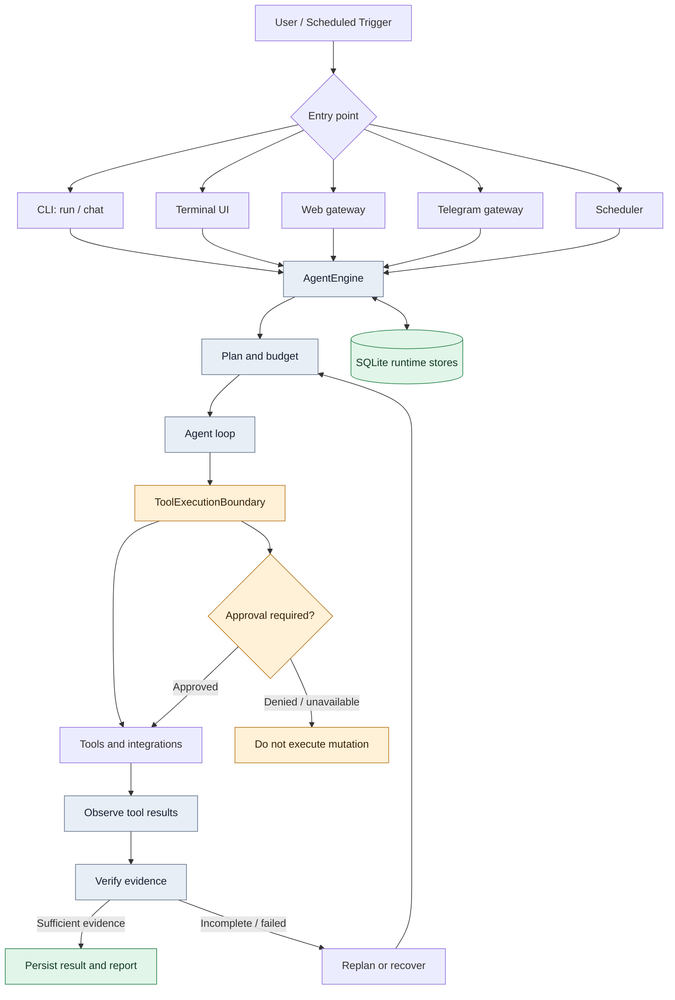
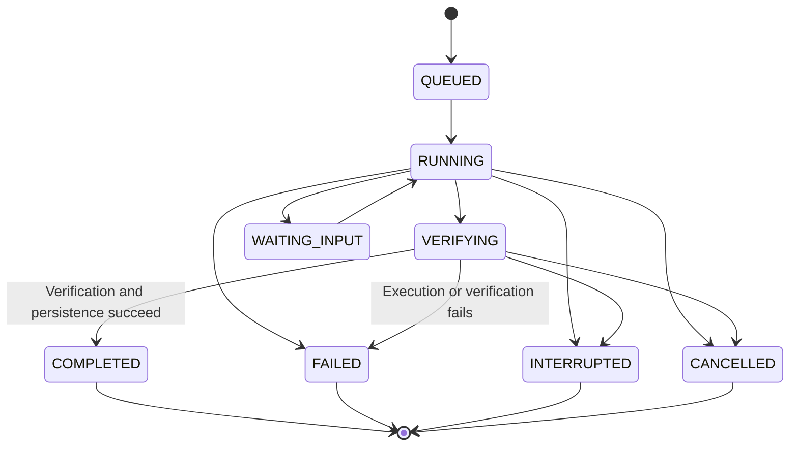

<p align="center">
  
</p>

<h1 align="center">EURUS</h1>

<p align="center">
  <strong>A provider-agnostic AI agent runtime for real work in your terminal.</strong>
  <br>
  Durable execution · approval-gated tools · coding workflows · web research · MCP · local web gateway
</p>

<p align="center">
  <a href="https://github.com/kyyinfinite/eurus/releases"></a>
  
  
  
</p>

<p align="center">
  
  
  
  
  
  
</p>

<p align="center">
  <a href="#-overview">Overview</a> ·
  <a href="#-supported-providers">Providers</a> ·
  <a href="#-features">Features</a> ·
  <a href="#-quick-start">Quick start</a> ·
  <a href="#-architecture">Architecture</a> ·
  <a href="#-safety-model">Safety</a> ·
  <a href="#-mcp-and-google-workspace">MCP</a> ·
  <a href="#-interfaces">Interfaces</a> ·
  <a href="#-development">Development</a>
</p>

<p align="center">
  
</p>

> [!WARNING]
> **Eurus is beta software.** APIs, configuration, persistence schemas, and behavior may still change between releases. Review every proposed or executed change, and do not rely on it for critical or unattended production work.

---

## ✨ Overview

Eurus is an async-first Python agent runtime that connects language models to tools and repeatable workflows. An agent plans a task, calls tools, inspects the results, decides what to do next, and reports only what it could verify.

<table>
  <tr>
    <td width="50%" valign="top">
      <h3>🔌 Provider-agnostic</h3>
      OpenAI-compatible endpoints, Anthropic, Gemini, and optional official Groq and Google GenAI SDKs, with configurable fallback chains.
    </td>
    <td width="50%" valign="top">
      <h3>💾 Durable by design</h3>
      Every run goes through one boundary, <code>AgentEngine</code>, which persists runs, events, tool attempts, checkpoints, approvals, and budgets in SQLite.
    </td>
  </tr>
  <tr>
    <td valign="top">
      <h3>✅ Honest about results</h3>
      A run is not marked <code>COMPLETED</code> until verification and persistence succeed. Unsupported claims are recorded as unverified, never as success.
    </td>
    <td valign="top">
      <h3>🛡️ Fail-closed safety</h3>
      Mutating tools need an approver. With no approver, the action is denied.
    </td>
  </tr>
  <tr>
    <td colspan="2" valign="top">
      <h3>📱 Small-footprint friendly</h3>
      Built with Android Termux and small VPS instances in mind. Optional integrations stay optional, and the core needs neither Docker nor a native compiler.
    </td>
  </tr>
</table>

---

## 🤖 Supported providers

Models are addressed as `provider/model`. Any OpenAI-compatible endpoint can be added through config.

<p align="center">
  
  
  
  
  
  
  
  
  
  
  
  
</p>

| Protocol | Providers |
|---|---|
| `openai` | OpenAI, Groq, NVIDIA NIM, OpenRouter, DeepSeek, Mistral, Together, xAI, Ollama, custom |
| `anthropic` | Anthropic |
| `gemini` | Gemini (REST) |
| `groq-sdk` / `genai-sdk` | Official Groq and Google GenAI SDKs (optional extras) |

---

## 🚀 Features

| | Area | What is included |
|---|---|---|
| 🧠 | **Agent execution** | Async tool-calling loop, deterministic and structured planners, bounded iterations, token, cost, and time budgets, interruption and cancellation |
| 💾 | **Durable runtime** | SQLite stores for runs, events, tool attempts, jobs, and checkpoints. Write-ahead tool attempts, safe resume, recovery classification |
| 🔎 | **Verification** | Step and completion checks that separate supported results from unverified claims. Research answers must carry citations |
| 🧑‍💻 | **Coding workflows** | Guarded file tools, project index, reviewable patchsets with SHA-256 freshness checks, validation runner, per-run undo, disposable git worktrees for coder subagents |
| 🌐 | **Web research** | `web_search`, `web_fetch`, and `deep_search` with no search API key, all behind a DNS-pinning network guard |
| 🧭 | **Browser automation** | Snapshot-driven Chromium control by element reference. Pure-Python CDP backend (Termux-friendly) or Playwright |
| 🧩 | **MCP platform** | Native MCP client and server, risk-classified tools, nine built-in Google Workspace services with OAuth 2.0 |
| 🧬 | **Memory and learning** | Trust-tiered memory with FTS5 retrieval, bounded prompt injection, lessons, validated skill learning with owner-approved promotion |
| 📄 | **Documents** | Read and create `.docx`, `.xlsx`, and `.pptx` with an approval-gated review workflow |
| 🔭 | **Observability** | Redacted traces, run inspection, history, events, and metrics, all read-only |
| ⏰ | **Automation** | Scheduler daemon and persistent Telegram reminders that survive restarts |

---

## ⚡ Quick start

### Requirements

- Python 3.11 or newer (CI covers 3.11 to 3.13)
- Git
- An API key for the provider you intend to use
- Docker or a compatible runtime if you want isolated shell execution on Linux

### Install

```bash
git clone https://github.com/kyyinfinite/eurus.git
cd eurus

python -m venv .venv
source .venv/bin/activate

python -m pip install --upgrade pip
pip install -e .
```

### Bootstrap the environment

The built-in environment manager detects your platform (Termux, Debian/Ubuntu proot, native Linux, containers and VPS), installs the extras you choose, writes the `~/.eurus/` layout, configures a provider, and verifies the result.

```bash
eurus bootstrap --check
eurus bootstrap --quick
eurus bootstrap --repair
eurus doctor
```

### Configure a provider

```bash
export GROQ_API_KEY="your-key"
eurus doctor
eurus providers
```

Keys can also live in `~/.eurus/.env`. Never commit `.env` or real credentials. [`.env.example`](.env.example) is the template.

### Run it

```bash
eurus ask --model groq/llama-3.3-70b-versatile "Explain what a mutex is in three sentences."
eurus run "Inspect this project and summarize its structure."
eurus chat
eurus-tui
eurus gateway web --open
```

Model IDs are illustrative and depend on your provider account.

<details>
<summary><b>📦 Optional extras</b></summary>

<br>

| Extra | Installs | Purpose |
|---|---|---|
| `[web]` | ddgs, trafilatura | Extra web research dependencies |
| `[web-gateway]` | FastAPI, uvicorn, pydantic | Local web gateway |
| `[telegram]` | aiogram | Telegram gateway |
| `[browser]` | Playwright | Browser backend for PC and VPS |
| `[browser-cdp]` | websockets | Raw CDP backend, Termux-friendly |
| `[documents]` | python-docx, openpyxl, python-pptx | Office tools |
| `[google]` | keyring, cryptography | OS keyring and encrypted token storage |
| `[groq]` / `[genai]` / `[sdk]` | Official SDKs | Groq and Google GenAI protocols |

```bash
pip install -e ".[web,web-gateway,documents]"
```

</details>

---

## 🏗️ Architecture

All production entry points converge on one durable execution boundary, `AgentEngine` in `src/eurus/runtime/engine.py`. Interfaces differ, but execution, persistence, verification, and recovery are shared.



| Layer | Responsibility | Location |
|---|---|---|
| `AgentEngine` | Run lifecycle, checkpoints, budgets, cancellation, final verification | `runtime/engine.py` |
| Agent loop and planners | Iteration, replanning, step and completion verification | `agent/` |
| `ToolExecutionBoundary` | Approval, mutation path locks, execution envelope enforcement | `tools/boundary.py` |
| Stores | Runs, events, tool attempts, jobs, checkpoints, sessions, memory, media | `storage/`, `sessions.py`, `memory/` |
| Recovery | Classifies interrupted runs and blocks unsafe resume | `runtime/resume.py` |
| Redaction and net guard | Secret redaction before persistence, validated network egress | `security/` |

<details>
<summary><b>🔁 Run lifecycle and recovery</b></summary>

<br>



- **Write-ahead tool attempts.** Mutating tools persist a `pending` row before they run, so a crash leaves a reconcilable trace.
- **No blind replay.** Runs with unresolved side effects cannot resume until reconciled by hand. Approvals are re-validated at resume time.
- **Observable failures.** Checkpoint failures surface as `checkpoint.failed` events and are never silent.
- **Bounded resources.** Subprocess output uses head+tail readers and event buffers are capped.
- **Storage.** SQLite in WAL mode with additive, versioned migrations.

If completion lacks sufficient evidence, the outcome is recorded as `completed_unverified`. Inspect evidence with `eurus trace <run_id>`.

</details>

---

## 🛡️ Safety model

Eurus is built to fail closed, but safety controls do not make an autonomous agent risk-free.

| Control | What it does |
|---|---|
| 🔐 **Approval-gated mutations** | Mutating tools pass an approval boundary. No approver means denied. CLI approval is scoped to the displayed call |
| 📜 **Execution envelope** | Each call is authorized by an immutable envelope: run identity, workspace, isolation backend, network profile (default `offline`), capabilities, budget, expiry |
| 📁 **Guarded workspace** | Relative paths only, no `..`, no symlinks, strict containment, atomic writes, `O_NOFOLLOW` opens |
| 🌍 **Network guard** | Public HTTP(S) only. Private, loopback, link-local, CGNAT, and metadata addresses are rejected. Redirects are validated and connections pinned against DNS rebinding |
| ☣️ **Untrusted content** | Web pages, memory, emails, documents, and MCP output are data, never instructions |
| 🕵️ **Secret redaction** | Events, approvals, logs, and traces are redacted before storage or display |
| 🧾 **Audit journal** | Security events are written to `<home>/security/execution.jsonl` with owner-only permissions |

These controls are defense-in-depth, not a security certification. Test in a disposable workspace, keep backups, and never give an experimental agent unrestricted access to secrets or production infrastructure. To report a vulnerability, see [SECURITY.md](SECURITY.md).

<details>
<summary><b>🐳 Shell isolation</b></summary>

<br>

By default the shell tool runs inside a container and Eurus never silently falls back to the host.

- No network, read-only root filesystem, all capabilities dropped, `no-new-privileges`, non-root user, plus CPU, memory, PID, timeout, and output limits.
- If the runtime is missing or unhealthy, execution fails with `sandbox_unavailable`.
- Optional hardening: image allowlist, digest pinning, default-deny seccomp profile, AppArmor profile.

```toml
[sandbox]
backend = "container"
runtime = "docker"
image = "python:3.12-alpine"
required = true
network = false
memory_mb = 1024
cpu_limit = 1.0
pids_limit = 128
```

**Termux and host mode.** Termux has no Docker-style runtime, so Eurus defaults to the non-isolated host backend with `sandbox.required = false`. Commands run directly on the device and are **not isolated**, so the approval gate is your only control.

</details>

---

## 🧩 MCP and Google Workspace

Eurus is both an **MCP client** and an **MCP server**. Every entry point builds its MCP stack through one `MCPRuntime`.

<p align="center">
  
  
  
  
  
  
  
  
  
</p>

All nine services are built in and **disabled by default**. Eurus requests only the scopes of the services you enable.

```bash
eurus mcp google list
eurus mcp google enable gmail
eurus auth google login
eurus mcp google status
```

| Risk level | Examples | Approval |
|---|---|---|
| `read_only` | search email, read documents | Not required (configurable) |
| `reversible_write` | create draft or document | Required |
| `sensitive_mutation` | send email, share files, change permissions | Required, cannot be disabled |
| `destructive` | delete email or Drive files | Required, cannot be disabled |
| `unknown` | unmatched tools, external-server tools by default | Required |

<details>
<summary><b>🔧 External servers and Eurus as a server</b></summary>

<br>

```bash
eurus mcp add-stdio filesystem python --arg server.py
eurus mcp add-http my-server https://example.com/mcp
eurus mcp list
eurus mcp doctor
```

```bash
eurus mcp server tools
eurus mcp server start --transport stdio --tool read_file --tool search_memory
eurus mcp server start --transport streamable-http --host 127.0.0.1 --port 8765 --tool read_file
```

Nothing is exposed by default. Tools are allowlisted explicitly, arguments are schema-validated, HTTP always requires a bearer token, and mutating tools are denied to external clients unless explicitly enabled.

</details>

> [!NOTE]
> Google Workspace MCP servers are part of Google's Developer Preview program. Availability and tool sets may change.

---

## 🖥️ Interfaces

<table>
  <tr>
    <td width="25%" valign="top">
      <h4>⌨️ CLI</h4>
      <code>ask</code>, <code>run</code>, <code>chat</code> with persistent sessions
    </td>
    <td width="25%" valign="top">
      <h4>🎨 Terminal UI</h4>
      Themes, model picker, slash commands, undo
    </td>
    <td width="25%" valign="top">
      <h4>🌐 Web gateway</h4>
      React UI over the same runtime, sessions, and approvals
    </td>
    <td width="25%" valign="top">
      <h4>✈️ Telegram</h4>
      Durable tasks, in-chat approvals, reminders
    </td>
  </tr>
</table>

<details>
<summary><b>🌐 Web gateway</b></summary>

<br>

A local REST + WebSocket API and React frontend over the **same** runtime as the CLI and TUI. A session created in the TUI is visible in the browser and vice versa.

```bash
eurus gateway web
eurus gateway web --open --port 9000
```

Build the frontend once, or use the Vite dev server:

```bash
cd frontend
npm ci
npm run build
```

Pages: dashboard, runs, sessions, chat, memory, providers, tools, logs, security, and configuration.

Local security: loopback by default, host-header allowlist, bearer-token auth on all routes and WebSocket upgrades, Origin/Referer validation on state-changing requests, no cookies, and validated uploads (20 MB cap, MIME allowlist, magic-byte sniffing).

</details>

<details>
<summary><b>✈️ Telegram gateway and scheduler</b></summary>

<br>

```bash
pip install -e ".[telegram]"
eurus setup telegram
eurus gateway telegram
```

Tasks persist with run linkage, attempt caps, and deadlines. Interrupted tasks resume only after `/resume`. Reminders (`create_reminder`, `list_reminders`, `reschedule_reminder`, `cancel_reminder`) survive restarts and skip missed intervals instead of flooding after downtime.

```bash
eurus schedule add ...
eurus schedule daemon
```

</details>

---

## 🧠 Web research, browser, memory

<details>
<summary><b>🌐 Web research and browser automation</b></summary>

<br>

| Tool | Description |
|---|---|
| `web_search` | Public web search through DDGS |
| `web_fetch` | Fetches one public page and extracts readable text (2 MB cap) |
| `deep_search` | Fetches up to five sources in parallel and returns evidence with URLs |

| Backend | Extra | Notes |
|---|---|---|
| `cdp` | `[browser-cdp]` | Direct DevTools Protocol. No Playwright or Node.js. Default on Termux |
| `playwright` | `[browser]` | Auto-waiting locators. Not available on Android |
| `remote` / `attach` | `[browser-cdp]` | Connects to an external Chromium and never closes it |

Clicks, typing, key presses, dialogs, screenshots, and uploads always need individual owner approval. The browser is disabled by default and uses a dedicated profile at `~/.eurus/browser/profile`.

</details>

<details>
<summary><b>🧬 Memory, sessions, and skills</b></summary>

<br>

- Memory lives in SQLite with FTS5 keyword retrieval and no vector service.
- Automatic extraction runs only over the user's own message. Tool, file, and web output is never trusted as memory policy.
- Memories are injected under a bounded budget and labeled. **Quarantined memories are never injected.**
- Learned skills are drafted into quarantine and installed only after validation and owner approval.

```bash
eurus memory list
eurus skills list
eurus skills promote NAME --yes --outcome "..."
```

</details>

---

## ⚙️ Configuration

Eurus reads `~/.eurus/config.toml` (override with `EURUS_HOME`). A complete example is in [`eurus.example.toml`](eurus.example.toml).

```toml
[agent]
model = "groq/llama-3.3-70b-versatile"
fallback = ["openai/gpt-4o-mini"]
iteration_budget = 500

[providers.myhost]
protocol = "openai"
base_url = "https://example.com/v1"
api_key_env = "MYHOST_API_KEY"

[network]
timeout_seconds = 120.0
max_retries = 3
local_only = false
cooldown_seconds = 30.0
```

- Rate limits, timeouts, and 5xx responses are retried with backoff and honor `Retry-After`.
- Authentication failures skip every remaining candidate on the same provider.
- A stream is retried or failed over only before its first token.
- Cost budgets apply only when a price is known for every model used. Eurus never invents an estimate.

`eurus diagnose` probes the model chain without running an agent:

```bash
eurus diagnose groq/llama-3.3-70b-versatile nvidia/meta/llama-3.3-70b-instruct
```

---

## 📚 Command reference

Use `eurus --help` and `eurus <command> --help` for what your installed version provides.

| Command | Purpose |
|---|---|
| `eurus ask` / `run` / `chat` | One-shot prompt, agent task, interactive session |
| `eurus-tui` | Terminal UI |
| `eurus gateway web` / `telegram` | Web and Telegram gateways |
| `eurus providers` / `diagnose` / `doctor` | Provider list, chain probe, health report |
| `eurus bootstrap` / `setup` | Environment manager and component setup |
| `eurus config`, `sessions`, `memory`, `privacy` | Configuration, history, memory, export and purge |
| `eurus skills` / `learn` | Skills and learning |
| `eurus mcp` / `auth google` | MCP client and server, Google auth |
| `eurus browser` / `schedule` | Browser control and scheduled jobs |
| `eurus trace`, `inspect`, `history`, `events`, `metrics` | Read-only run inspection |
| `eurus resume` / `cancel` / `undo` | Run recovery, cancellation, undo |
| `eurus eval` / `benchmark` | Deterministic evaluation suite |

---

## 🚧 Known limitations

- **Docker isolation is not yet validated against a real daemon.** Container invocation is covered by mock-based tests only.
- **Termux runs unisolated.** Host mode relies entirely on the approval gate.
- **Browser DNS-rebinding gap.** Chromium resolves third-party subresources itself, so address pinning does not apply there.
- **Web gateway providers are text-only.** Uploaded images, audio, and video are stored but not sent as vision or audio content.
- **Undo covers file tools only.** Shell mutations, files over 1 MB, and non-UTF-8 files are not restored.
- **Memory retrieval is lexical.** There are no learned embeddings yet.

## 🗺️ Roadmap

- Richer deterministic verifiers selected by plan step and changed files
- Session-scoped approvals for narrowly defined safe patterns, with expiry and revocation
- Optional remote embedding providers for memory retrieval
- More orchestration roles on the graph scheduler behind the same trusted boundary

---

## 🛠️ Development

```bash
pip install -e ".[dev]"
ruff check .
ruff format --check .
python -m compileall -q src
mypy
pytest -q
```

CI runs linting, formatting, strict type checks, tests, packaging checks, and command smoke tests on Python 3.11 to 3.13.

<details>
<summary><b>📂 Project layout</b></summary>

<br>

```text
src/eurus/
├── agent/          loop, planners, verification, delegation
├── runtime/        AgentEngine, state machine, recovery
├── tools/          registry and ToolExecutionBoundary
├── execution/      execution envelope, container sandbox
├── coding/         file tools, patchsets, checks, office tools
├── providers/      protocol adapters and router
├── browser/        CDP and Playwright backends, snapshots, policy
├── mcp/            client, server, Google Workspace provider, OAuth
├── gateway/        web (FastAPI) and telegram
├── memory/ learning/ skills/ sessions.py
├── tui/ cli/ bootstrap/
└── security/       redaction, net guard, audit journal
frontend/           React web gateway UI
tests/              deterministic test suite
```

</details>

## 🤝 Contributing

1. Fork the repository and branch from `main`.
2. Install with `pip install -e ".[dev]"`.
3. Run `ruff check .`, `ruff format --check .`, `mypy`, and `pytest` before opening a pull request.
4. Keep pull requests small and focused, with tests for behavior changes.

Eurus is implemented from scratch. Do not paste or translate code from other projects, including AGPL or GPL projects. Permissively licensed code may be used only with its notice recorded in a `NOTICE` file.

## 🔒 Security

Please do not open public issues for vulnerabilities. See [SECURITY.md](SECURITY.md) for private reporting.

## 📄 License

Released under the [MIT License](LICENSE).

<p align="center">
  <sub>Built by <a href="https://github.com/kyyinfinite">Ripki Dwi Putra</a> · kyyinfinite</sub>
</p>
