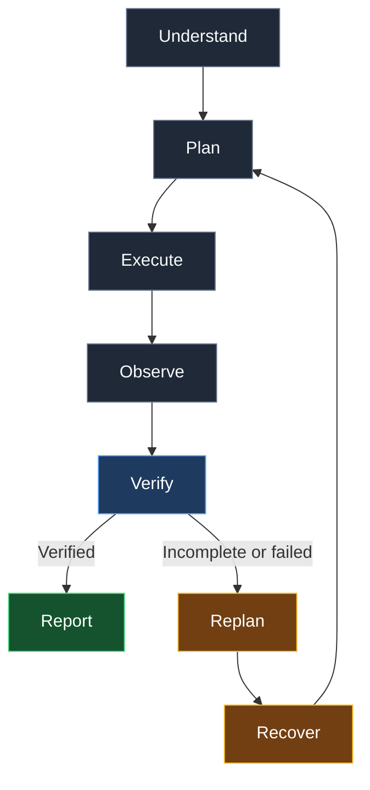
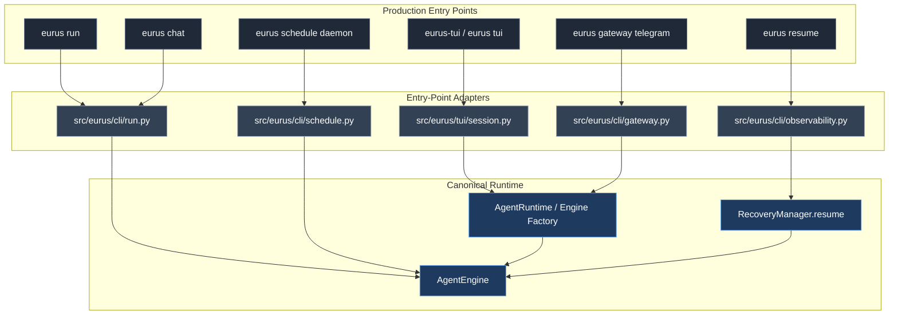
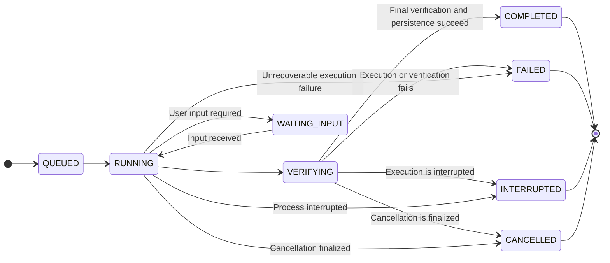
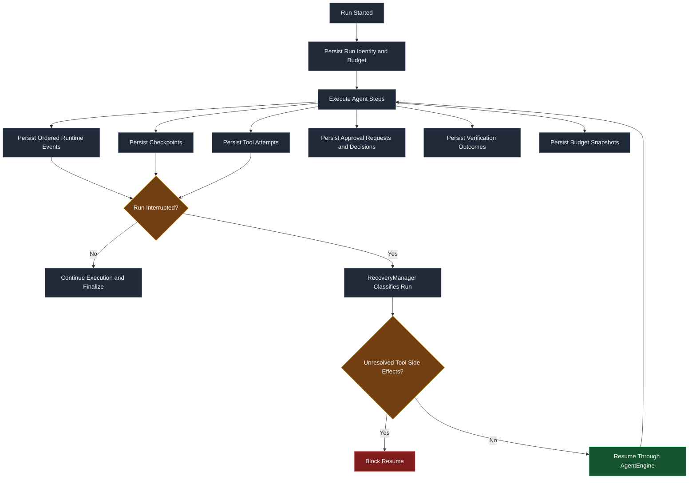
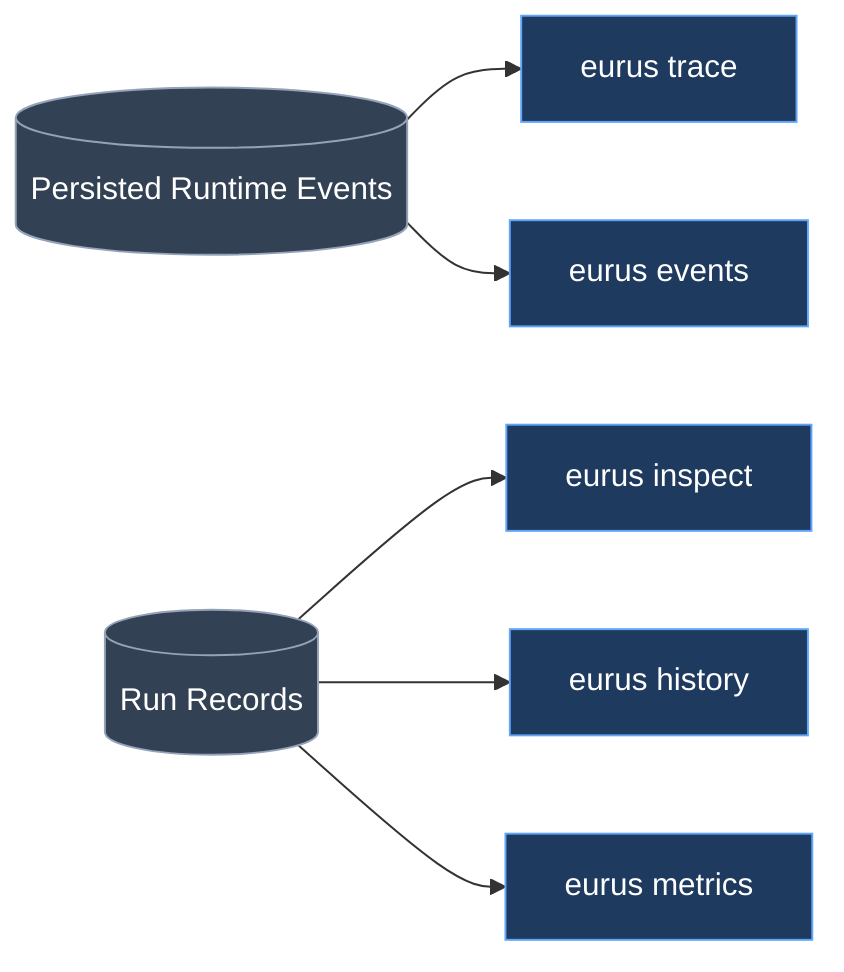

# Architecture and Execution Flow

Eurus is an async-first Python 3.11+ agent runtime. Every production execution path passes through one canonical execution boundary: the durable `AgentEngine` in `src/eurus/runtime/engine.py`.

## Canonical Execution Lifecycle

Every run follows the same lifecycle, from understanding the request to producing a verified report.

## Production Entry Points

All production entry points converge on `AgentEngine`. Interfaces may differ, but execution, persistence, verification, and recovery share the same runtime boundary.

### Entry-Point Reference

| Entry Point | Module | Execution Path |
|---|---|---|
| `eurus run` | `src/eurus/cli/run.py` | `_run_once` builds an agent and engine, streaming events through `on_event`. |
| `eurus chat` | `src/eurus/cli/run.py` | Each turn uses the same engine execution boundary with a session ID. |
| `eurus-tui` / `eurus tui` | `src/eurus/tui/session.py` | `AgentRuntime(engine_factory=...)` wraps every turn. |
| `eurus gateway telegram` | `src/eurus/cli/gateway.py` | `AgentRuntime(engine_factory=...)` wraps every task. |
| `eurus schedule daemon` | `src/eurus/cli/schedule.py` | An engine is created for each scheduled job. |
| `eurus resume <run_id>` | `src/eurus/cli/observability.py` | `RecoveryManager.resume` reconstructs execution through an engine. |

## Core Architecture

The runtime separates agent reasoning, tool execution, lifecycle management, durable storage, recovery, planning, verification, and memory.

```mermaid
flowchart TB
    ENGINE["AgentEngine<br/>runtime/engine.py"]

    subgraph Agent["Agent Layer"]
        LOOP["Agent Loop<br/>agent/loop.py"]
        PLANNER["Planner<br/>agent/planner.py"]
        STRUCTURED["Structured Planner<br/>agent/structured_planner.py"]
        VERIFY["Verification<br/>agent/verification.py"]
    end

    subgraph Security["Execution Boundary"]
        BOUNDARY["ToolExecutionBoundary<br/>tools/boundary.py"]
        APPROVAL["Fail-Closed Approval"]
        LOCKS["Mutation Path Locks"]
        UNCERTAIN["Uncertain-Outcome Tracking"]
    end

    subgraph Persistence["Durable Storage"]
        RUNSTORE["RunStore"]
        EVENTS["EventStore"]
        ATTEMPTS["ToolAttemptStore"]
        JOBS["JobStore"]
        CHECKPOINTS["Run Checkpoints"]
    end

    subgraph Supporting["Supporting Systems"]
        RECOVERY["Recovery Manager<br/>runtime/resume.py"]
        MEMORY["Memory System<br/>memory/"]
        REDACTION["Secret Redaction<br/>security/redaction.py"]
        STATE["State Machine<br/>runtime/state_machine.py"]
    end

    ENGINE --> LOOP
    ENGINE --> STATE
    ENGINE --> RECOVERY
    ENGINE --> RUNSTORE
    ENGINE --> EVENTS
    ENGINE --> ATTEMPTS
    ENGINE --> JOBS
    ENGINE --> CHECKPOINTS
    ENGINE --> VERIFY

    LOOP --> PLANNER
    LOOP --> STRUCTURED
    LOOP --> BOUNDARY
    LOOP --> VERIFY
    LOOP -. advisory context .-> MEMORY

    BOUNDARY --> APPROVAL
    BOUNDARY --> LOCKS
    BOUNDARY --> UNCERTAIN
    BOUNDARY --> ATTEMPTS

    ENGINE --> REDACTION
    REDACTION --> EVENTS

    classDef core fill:#1e3a5f,stroke:#60a5fa,color:#ffffff
    classDef security fill:#713f12,stroke:#fbbf24,color:#ffffff
    classDef storage fill:#14532d,stroke:#4ade80,color:#ffffff
    classDef support fill:#334155,stroke:#94a3b8,color:#ffffff

    class ENGINE,LOOP,PLANNER,STRUCTURED,VERIFY core
    class BOUNDARY,APPROVAL,LOCKS,UNCERTAIN security
    class RUNSTORE,EVENTS,ATTEMPTS,JOBS,CHECKPOINTS storage
    class RECOVERY,MEMORY,REDACTION,STATE support
```

### Agent Loop

`src/eurus/agent/loop.py` handles:

- Iteration budgets and bounded execution.
- Tool invocation through `ToolExecutionBoundary`.
- Progress tracking and observation.
- Replanning when the current approach is insufficient.
- Step-level and completion verification.

### Tool Execution Boundary

`src/eurus/tools/boundary.py` enforces the security boundary for tool execution:

- Every mutating tool requires an approver. Without one, the operation is denied.
- Mutations use path locks to prevent conflicting concurrent operations.
- Uncertain outcomes are tracked so unresolved side effects are not blindly replayed.
- Tool attempts and structured outcomes are recorded durably.

### AgentEngine

`src/eurus/runtime/engine.py` owns the canonical run lifecycle:

- Durable run records and checkpoints.
- Runtime event emission.
- Execution budgets and cancellation.
- State-machine validation.
- Final verification and persistence before a run is marked completed.

### Planning and Verification

The planning subsystem provides a deterministic template planner and an optional model-driven structured planner. Structured plans undergo strict schema validation and use a deterministic fallback when necessary.

`src/eurus/agent/verification.py` provides evidence-based step and completion verification for agents constructed through `build_agent`.

### Memory

The memory subsystem in `src/eurus/memory/` provides:

- FTS5 keyword retrieval by default.
- An optional hybrid provider combining keyword matches with fuzzy lexical matching over hashed n-gram vectors.
- Trust tiers that keep untrusted content out of trusted prompts.

The hybrid provider uses deterministic feature hashing rather than learned semantic embeddings. Memory remains advisory and cannot weaken execution policies.

## Run State Machine

The state machine in `src/eurus/runtime/state_machine.py` rejects invalid transitions.

A run is never marked `COMPLETED` until final verification and persistence succeed. If completion lacks sufficient evidence, the outcome is recorded as `completed_unverified`, not as verified success.

`INTERRUPTED` is the canonical spelling used in the diagram; use the exact persisted enum value defined by the implementation when documenting or changing the state machine.

## Durable Execution and Recovery

Eurus persists the information required to reconstruct execution history and safely assess whether a run can resume.

Each run durably records:

- Run identity, owner, session, budget, and status versioning.
- Ordered runtime events in `eurus_runtime_events`.
- Checkpoints in `eurus_run_checkpoints`, including a capped snapshot of the
  agent conversation history so a resumed run keeps its context.
- Tool attempts in `eurus_tool_attempts` with write-ahead `pending` rows:
  mutating and approval-gated tools persist an uncertain `pending` row before
  execution starts, and the final outcome upserts that row in place. A crash
  between the two leaves the pending row behind, which recovery treats as an
  unresolved side effect requiring reconciliation.
- Approval requests and decisions with action fingerprints.
- Verification outcomes with supporting evidence.
- Budget snapshots, including token and estimated cost usage.

Recovery classifies interrupted runs and blocks resumption when tool side effects remain unresolved. Checkpoint saves run off the event loop
(`asyncio.to_thread`) and report failures as `checkpoint.failed` runtime events
instead of failing silently; a failed checkpoint never kills the run, but it is
always observable.

SQLite runtime storage runs in WAL mode with `synchronous=NORMAL` and a busy
timeout; connections come from a small thread-safe pool so reads and writes do
not reopen a database connection per operation. In-memory event buffers in the
engine are bounded (tail-preserving) with explicit dropped-event counters on
`RunResult`, so long runs cannot grow without limit.

Secrets, credentials, and private environment values are redacted before runtime events are stored. The implementation is located in `src/eurus/security/redaction.py`.

## Observability

Eurus exposes read-only inspection commands for examining execution history and diagnosing failures.

### Observability Commands

| Command | Purpose |
|---|---|
| `eurus trace <run_id>` | Reconstructs a chronological, redacted runtime timeline. |
| `eurus inspect` | Inspects run details. |
| `eurus history` | Reviews historical runs. |
| `eurus events` | Examines persisted runtime events. |
| `eurus metrics` | Reports runtime metrics. |

All tracing and observability views are read-only.

## Design Guarantees

- **One canonical execution boundary:** Production tasks execute through `AgentEngine`.
- **Fail-closed mutation approval:** Mutating operations are denied when no approver is available.
- **Durable execution:** Run state, events, checkpoints, tool attempts, approvals, verification results, and budget snapshots are persisted.
- **Write-ahead tool attempts:** Mutating tools persist a `pending` attempt row before execution; crashes leave a reconcilable trace instead of silence.
- **Honest failure reporting:** Tool failures, timeouts, checkpoint failures, and swallowed fallbacks are surfaced as errors, runtime events, or log warnings - never silently discarded.
- **Bounded execution resources:** Subprocess output is streamed through head+tail bounded readers; engine event buffers and boundary lock maps are capped and cleaned up.
- **Safe recovery:** Unresolved side effects prevent blind replay.
- **Evidence-based completion:** Successful completion requires verification and persistence.
- **Constrained memory trust:** Retrieved content cannot silently change execution policy.
- **Redacted observability:** Stored event data excludes secrets and private environment values.
- **Additive database migrations:** SQLite schema evolution preserves existing data through versioned migrations.

## Runtime Requirements

- Python 3.11+
- Async-first execution model
- SQLite-backed persistence
- Pure-Python core dependencies where practical
- Optional integrations must not make the core runtime dependent on Docker or native compilation

For implementation details, see the corresponding modules under `src/eurus/`.

## Home, Workspace, and Storage Layout (0.2.0)

Since 0.2.0 the runtime has a single authoritative resolver for every filesystem location:

- `eurus.home.HomeManager` owns `~/.eurus` (or `$EURUS_HOME`), creates directories lazily with 0700 permissions, tightens drifted permissions on existing directories, and maintains `system/version` and `system/manifest.json`.
- The runtime database lives at `~/.eurus/data/eurus.sqlite3`. Existing installations are migrated automatically on first use from the legacy `~/.eurus/sessions.sqlite3` through a checkpointed, verified, lock-serialized copy; the legacy file is preserved for rollback.
- `eurus.workspace.WorkspaceManager` owns workspace scopes: the configured default workspace plus managed scopes under `~/.eurus/workspace/` (`projects/`, `temp/runs/`, `automation/`, `shared/`, `artifacts/`). It provides traversal/symlink-safe resolution and descriptor-relative (`O_NOFOLLOW`) open primitives for security-sensitive file operations.

Design details and the migration procedure: [architecture/HOME_AND_WORKSPACE.md](architecture/HOME_AND_WORKSPACE.md). Program status and milestones: [plans/IMPLEMENTATION_PHASES.md](plans/IMPLEMENTATION_PHASES.md), audit: [plans/IMPLEMENTATION_AUDIT.md](plans/IMPLEMENTATION_AUDIT.md), risks: [plans/RISK_REGISTER.md](plans/RISK_REGISTER.md).
